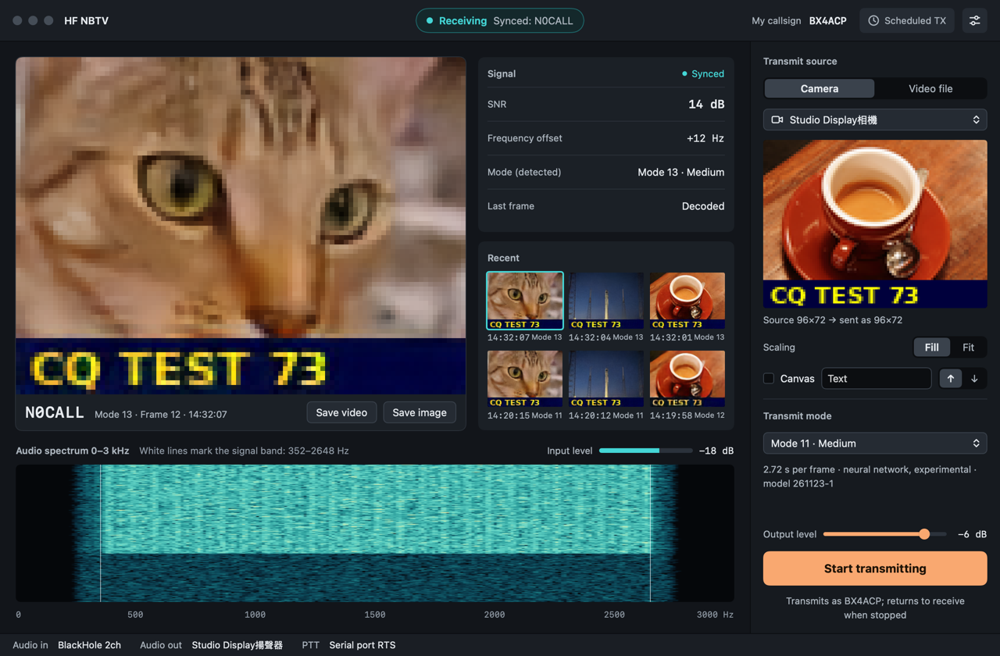
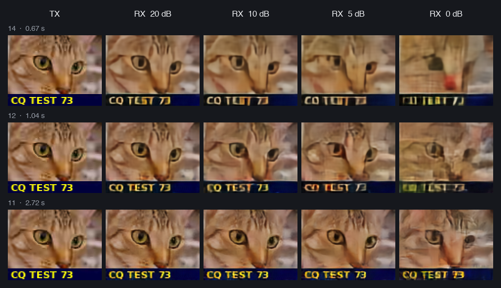
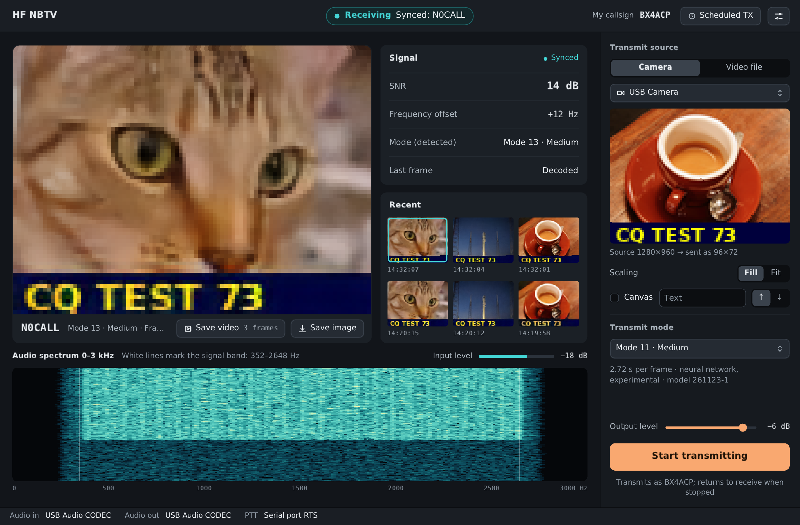

# NBeeTv

[繁體中文](README.md) · [简体中文](README.zh-CN.md) · [日本語](README.ja.md) · [Español](README.es.md) · **English**

[](https://github.com/pepefrog1234/NBeeTv/actions/workflows/build.yml)

Narrow-band television (NBTV) for HF amateur radio. It sends and receives 96×72 color pictures through the audio of an ordinary SSB transceiver, as fast as one picture every 0.67 seconds.

A neural network turns each picture directly into the values carried on the OFDM carriers. There is no quantization and no error-correcting code, so as the signal gets weaker the picture gets blurrier instead of dropping out.



> Still experimental: the modulation, the models and the receiver have been validated mostly with channel simulation, and on-air testing has been limited so far.

## What a received picture looks like



The left column (TX) is the picture that was sent. The four columns to its right (RX) show how it comes out of a simulated HF channel at signal-to-noise ratios of 20, 10, 5 and 0 dB.
From top to bottom are modes 14, 12 and 11, which take 0.67, 1.04 and 2.72 seconds per picture. A slower mode sends more values per picture, so the picture is finer.

- The channel is the "poor" channel of the Watterson model: two paths of equal strength 2 ms apart, each fading on its own, with a Doppler spread of 1 Hz. SNR is measured in a 3 kHz noise bandwidth.
- Each cell is the frame of median quality out of 9 sent in a row, not the best one. Merging of recent frames was turned off in the receiver.
  At 0 dB, between 1 and 4 of the 9 frames were not received; the cell shows the median of those that were.
- The figure was made with the command-line tools in the download packages: `nbtv-tx` → `nbtv-chan` → `nbtv-rx`.

## How it works

- **Signal**: OFDM with 49 carriers spaced 46.875 Hz apart, occupying 352–2648 Hz, which fits in an SSB voice passband.
  Each frame is one picture. It starts with two preamble symbols for synchronization and has pilots scattered through it.
- **Picture coding**: a convolutional network turns the 96×72 picture into a list of real numbers, which go out in pairs as the I and Q values of the carriers.
  A second network turns the received values, together with the measured SNR, back into a picture. Noise, fading and missing values were part of the training, so however poor the received values are, the result is just a blurrier picture.
- **Header**: each frame also carries the callsign and a frame number, protected by a convolutional code and a CRC. The picture can be decoded without the header.
- **Receiver**: it detects the mode automatically and tolerates a frequency error of ±150 Hz and a sample-clock error of ±100 ppm. When the signal is too weak for the header to decode, it keeps receiving at the frame cadence.
  It can also merge the values received in the last few frames before decoding, which sharpens the parts of the picture that have not changed. This happens only in the receiver; the transmitter does nothing different.
- **Both ends need the same model**: the weight files are in `models/` and are included in the download packages and in the app.

## The four modes

| Mode | Per picture | Real numbers per picture | 0 dB | 10 dB | 20 dB | Notes |
| --- | --- | --- | --- | --- | --- | --- |
| 14 | 0.67 s | 1512 | 20.8 | 24.3 | 26.2 | Fastest |
| 12 | 1.04 s | 2592 | 21.8 | 25.6 | 27.8 | |
| 11 | 2.72 s | 7776 | 24.3 | 29.2 | 32.8 | Finest picture |
| 13 | 2.72 s | 7776 | 24.4 | 29.4 | 33.1 | Same frame as mode 11, with a network four times larger |

The three numeric columns are picture quality (PSNR, in dB): the average over 16 photos that were not used in training, through the complete transmit and receive chain and the simulated "poor" channel described above.
Results for the white-noise channel and other SNRs, and how they were measured, are in the [technical notes](docs/TECHNICAL.md).

There is also an experimental **mode 15** for FM voice channels on VHF/UHF: the picture grows to 192×144, at 2.72 seconds per picture.
Audio SNR on FM is high, and sending a larger picture with the same number of values makes it clearly sharper; with a weak signal it does
worse than the four modes above, so it is not suited to HF. The command-line tools, the macOS app and the Windows and Linux app
can all send and receive it. It has only been checked in simulation, not yet on real radios.
Details are in the [technical notes](docs/TECHNICAL.md).

Also for FM, there are experimental **modes 5, 6 and 7**: the picture is still 192×144, but the frame carries no pilots.
The FM audio channel does not change during a frame, so the pilots can go, and the same time carries 20% more data.
Mode 5 uses the same model as mode 15 at 2.29 seconds per picture; mode 6 takes 2.88 seconds and is 1.4 dB better;
mode 7 takes 4.43 seconds and is 3.6 dB better. They only work on FM voice channels with no frequency offset and a steady signal
(not on SSB); they too are supported by the command-line tools and both apps. Modes 5 and 6 were tried over a pair of real FM radios
on 2026-11-27: with enough signal every picture is received, and the receiver was improved from those recordings
(with a weak signal it receives a few more pictures, a little sharper). Mode 7 has only been checked in simulation.

The same kind of frame also has two experimental fast modes, **modes 3 and 4**, both using the network four times larger.
Mode 3 has a 96×72 picture at 0.67 seconds per picture, as fast as mode 14; dropping the pilots makes room for 2 more channels
and its model is trained only for FM signal levels, so it is 1.8 dB better than mode 14. Mode 4 is a 192×144 picture at 1.01 seconds:
2.7 dB below mode 5, but about 3 dB better than an equally fast 96×72 picture enlarged to the same size. Mode 4 takes about four times
the computation of the other large-picture modes (about 0.13 seconds to decode one picture on an M4 Max), so a slow computer
with few cores may not keep up. They too work only on FM and have only been checked in simulation.

The FM modes (3–7 and 15) can also **carry live voice along with the pictures** (experimental): the audio band of the FM voice channel
is split in two, with voice at 360–1220 Hz using [FreeDV](https://freedv.org)'s RADE V2 and the picture slowed down 1.5 times (or 1.8 times)
and moved above 1335 Hz, so each picture takes that much longer. The macOS app and the Windows and Linux app have a "Send voice too" switch
in the sidebar (in versions after 0.2.1); both ends have to turn it on and pick the same layout, and with it off everything works as before.
It has only been checked in simulation, not yet on real radios, and RADE V2 itself is still a pre-release that FreeDV does not yet recommend
using on the air. Details are in the [technical notes](docs/TECHNICAL.md#語音與畫面共用-fm-語音通道實驗中).

## Download

Get the file for your platform from [Releases](https://github.com/pepefrog1234/NBeeTv/releases). Each one is built and tested on a machine of that platform and processor type.

| Platform | Processor | File | Contents |
| --- | --- | --- | --- |
| macOS 14 or later | Apple silicon | `NBeeTv-<version>-macos-arm64-app.zip` | NBTV.app, the graphical app for receiving and transmitting |
| macOS 14 or later | Intel | `NBeeTv-<version>-macos-x86_64-app.zip` | NBTV.app |
| macOS 11 or later | Apple silicon | `NBeeTv-<version>-macos-arm64.tar.gz` | Command-line tools |
| macOS 11 or later | Intel | `NBeeTv-<version>-macos-x86_64.tar.gz` | Command-line tools |
| Linux | x86_64 | `NBeeTv-<version>-linux-x86_64.tar.gz` | Desktop app (`nbtv-gui`, needs glibc 2.35 or later) and command-line tools (statically linked, for any distribution) |
| Linux | arm64 | `NBeeTv-<version>-linux-arm64.tar.gz` | Desktop app and command-line tools (same as above) |
| Windows 10, 11 | x86_64 | `NBeeTv-<version>-windows-x86_64.zip` | Desktop app (`nbtv-gui.exe`) and command-line tools |
| Windows 11 | arm64 | `NBeeTv-<version>-windows-arm64.zip` | Desktop app and command-line tools |

Every package includes the weight files for all the modes and works as soon as it is unpacked. Builds of commits that have not been released yet can be downloaded from the Artifacts of each run under [Actions](https://github.com/pepefrog1234/NBeeTv/actions/workflows/build.yml) (you need to be signed in to GitHub; they are kept for 7 days).

### The macOS app

NBTV.app is not signed with an Apple Developer ID and is not notarized; it has only an ad-hoc signature. macOS therefore blocks it the first time you open it after downloading.
Once you are sure the file came from this repository, allow it in either of these ways:

- Open it once (it will be blocked), then go to System Settings → Privacy & Security, scroll to the bottom and click Open Anyway; or
- Run `xattr -dr com.apple.quarantine /Applications/NBTV.app` in Terminal (use the path where you put the app).

First use:

1. Click the settings button at the top right (or press ⌘,). Enter your callsign, choose the audio input and output devices, and choose how PTT is keyed:
   not at all (use the radio's VOX), RTS or DTR on a serial port, CAT commands, or a rigctld that is already running. The last two need [Hamlib](https://github.com/Hamlib/Hamlib) installed separately.
2. macOS asks for microphone access (receiving reads from the audio input device), and for camera access when you choose the camera as the transmit source.
3. Back in the main window, it is already receiving. Choose the transmit source (camera, video file or a sequence of images) and the transmit mode in the sidebar, then click Start transmitting.

The app can also transmit on a schedule, print a line of text on the picture (Canvas), and save received pictures as an image or a video. Its interface is available in Traditional Chinese, Simplified Chinese, Japanese, Spanish and English, and follows the system language.
The full guide is in [apps/macos/README.md](apps/macos/README.md).

### The Windows and Linux app

The Windows and Linux packages contain `nbtv-gui` (`nbtv-gui.exe` on Windows): the graphical interface of the macOS app ported over, with the same layout and the same receive and transmit behavior. Run it right after unpacking; it has to stay in the same folder as `models/`.



*This picture was rendered by the program itself on Linux, without opening a window, from demo data.*

- **Windows**: the executable is not code-signed, so SmartScreen may block it the first time. Once you are sure the file came from this repo, click "More info → Run anyway".
- **Linux**: needs glibc 2.35 or later (Ubuntu 22.04, Debian 12, Raspberry Pi OS bookworm and newer). The Chinese and Japanese interface text needs system fonts (for example `fonts-noto-cjk`); without them the interface is shown in English.
- Using a video file as the transmit source, and saving received pictures as a video, use [ffmpeg](https://ffmpeg.org): the Windows packages already include it (`ffmpeg.exe`), so there is nothing to install; on Linux, install it separately (for example `sudo apt install ffmpeg`). Image files and image sequences do not need ffmpeg. Controlling PTT with CAT commands needs [Hamlib](https://github.com/Hamlib/Hamlib).

> This app is new. It has thorough automated checks in CI, but **nobody has used it yet on a real Windows or Linux computer connected to a radio**: real sound cards, cameras and serial-port PTT have not been verified on actual hardware. Before relying on it, read "驗證過與還沒驗證的" (what has and has not been verified) in [apps/desktop/README.md](apps/desktop/README.md) (in Traditional Chinese), and please report problems in Issues.

### Command-line tools

Every package includes the command-line tools. They work on files rather than live audio: to transmit, you play the generated WAV file into the radio; to receive, you record the radio's audio to a WAV file and decode it.

After unpacking, the executables and `models/` are in the same folder and can be run right there. Pictures are always 96×72 binary PPM files (192×144 for modes 4–7 and 15), which ffmpeg can produce (the Windows packages include `ffmpeg.exe`).

```sh
# Convert a photo to a 96×72 PPM
ffmpeg -i photo.jpg -vf scale=96:72 -pix_fmt rgb24 photo.ppm

# Make a WAV to play straight into the radio (--mode is 11 to 15, --call is your callsign)
./nbtv-tx --mode 14 --call N0CALL --out tx.wav photo.ppm

# Decode a recording into pictures: received/frame_0.ppm, frame_1.ppm, ... (--merge: merge recent frames before decoding)
mkdir received
./nbtv-rx --merge --out-dir received recording.wav

# Try it without a radio: send tx.wav through a simulated HF channel, then decode it
./nbtv-chan --channel poor --snr 10 tx.wav rx.wav
./nbtv-rx --out-dir received rx.wav
```

- On Windows, use `.\nbtv-tx.exe` in place of `./nbtv-tx`, and likewise for the other tools.
- On macOS, if the tools are blocked, first run `xattr -dr com.apple.quarantine <folder>` on the unpacked folder.
- Recordings must be WAV files at 12000 or 48000 Hz, 16-bit PCM or 32-bit float. If there is more than one channel, the first one is used.

| Tool | Purpose |
| --- | --- |
| `nbtv-tx` | Pictures → a WAV to play into the radio |
| `nbtv-rx` | WAV → the pictures received; `--json` gives output for other programs to read |
| `nbtv-chan` | Sends a WAV through a simulated HF channel (fading, noise, frequency offset, sample-clock error) |
| `nbtv-sim` | Runs transmit → channel → receive many times and reports how many frames arrive and how good they are |
| `nbtv-learned` | Tests only the model that maps a picture to channel values and back, without the modem |

Each tool lists all of its options with `--help` (the help text is in Traditional Chinese only for now).

## Reception card

The author's station, **BX4ACP**, transmits this signal. Record the audio from your radio to a WAV file and upload it to <https://nbeetv.yakumo.tw>.
If more than 10 pictures decode and the callsign is decoded, the site issues you a digitally signed reception card. No sign-in is needed, and a recording can be up to 5 minutes long.

The code for that site is in this repository too ([apps/web/](apps/web/README.md)), so you can run one for your own station.

## Before connecting a radio

- Use USB (or a data mode) at both ends. The transmit and receive filters must both cover 352–2648 Hz; anything narrower cuts off the carriers at the edges.
- The two radios must be within ±150 Hz of each other.
- Turn off anything that reshapes the waveform: speech compression and equalization on transmit, noise reduction (NR) and auto notch on receive.
- OFDM has peaks far above its average level. Turn the output level down until the ALC stops acting; the average power will be well below the radio's rated power, which is normal.
- Before transmitting, make sure your local regulations allow this kind of emission.

## Building from source

You need CMake 3.20 or later and a C++20 compiler (GCC, Xcode's clang and Visual Studio's MSVC all work). The core needs no other libraries.

```sh
git clone https://github.com/pepefrog1234/NBeeTv.git
cd NBeeTv
cmake -S . -B build
cmake --build build --config Release
ctest --test-dir build -C Release --output-on-failure
```

The tools end up in `build/tools/` (`build/tools/Release/` with Visual Studio). The tests use the weight files in `models/` and take a few minutes to run.

The macOS app uses a separate build directory and needs Xcode and Ninja:

```sh
cmake -S . -B build-app -G Ninja -DNBTV_BUILD_MACOS_APP=ON -DNBTV_BUILD_TESTS=OFF -DNBTV_BUILD_TOOLS=OFF
cmake --build build-app
open build-app/apps/macos/NBTV.app
```

The Windows and Linux app (the configure step downloads SDL, Dear ImGui and stb; the packages Linux needs first are listed in [apps/desktop/README.md](apps/desktop/README.md)):

```sh
cmake -S . -B build-desktop -DNBTV_BUILD_DESKTOP_APP=ON -DNBTV_BUILD_TESTS=OFF
cmake --build build-desktop --config Release --target nbtv-gui
```

The voice codec behind "Send voice too" is not built by default (the programs in the download packages after 0.2.1 have it). To include it, add
`-DNBTV_VOICE=ON` to any of the `cmake -S …` lines above: the configure step then also downloads the sources of
[rade_c](https://github.com/freedv/rade_c) and [Opus](https://github.com/xiph/opus) and Opus's model data (about 280 MB in all,
each checked against its SHA-256) and builds them along with the project; nothing else needs to be installed.

| Path | Contents |
| --- | --- |
| `core/` | Platform-independent C++20 core library: OFDM transmit and receive, synchronization, channel estimation and neural-network inference. Its only public interface is a C API (`core/include/nbtv/nbtv.h`) |
| `sim/` | HF channel simulation |
| `voice/` | Wrapper around the real-time voice codec (FreeDV's RADE V2) for "Send voice too"; optional |
| `tools/` | Command-line tools; `tools/learned/` holds the training and export code for the models (Python, PyTorch) |
| `models/` | Model weight files |
| `apps/macos/` | The macOS app (SwiftUI) |
| `apps/desktop/` | The Windows and Linux app (C++, SDL 3, Dear ImGui) |
| `apps/web/` | The reception-card website (Python, FastAPI) |

## Current limitations

- Text and captions get smeared, and small patches of vivid color fade.
- Nothing authenticates a frame or its callsign: anyone can send pictures under any callsign.
- The Windows and Linux app is new and has only been checked by automated tests; it has not yet been verified with a real radio, sound card, camera or serial port.
- "Send voice too" has only been checked in simulation. RADE V2 is still a pre-release: its waveform may change, and versions before and after such a change cannot hear each other.
- The help text of the command-line tools and the detailed documents below are in Traditional Chinese only for now.

## Documentation

These documents are in Traditional Chinese.

- [Technical notes](docs/TECHNICAL.md): simulation results, receiver behavior, frame structure and design trade-offs, and what is not done yet
- [The macOS app](apps/macos/README.md)
- [The Windows and Linux app](apps/desktop/README.md)
- [Models and training](tools/learned/README.md)
- [The reception-card website](apps/web/README.md)
- [Draft specification v0.1](短波%20NBTV%20軟體規格草案%20v0.1.md): written before the switch to neural-network coding; the parts on OFDM parameters, the preamble and the pilots still apply

## License

The code is released under the [GNU General Public License, version 3 (GPL-3.0)](LICENSE).

The model weights (`models/`) were trained on photos from [COCO](https://cocodataset.org/) val2017. The copyright in those photos belongs to their photographers, who released them under various Creative Commons licenses, some of which allow non-commercial use only.
The weights are provided with the project. Before using them for anything other than amateur radio experiments, check for yourself that the use is allowed.

The programs in the download packages after 0.2.1 are also linked with [rade_c](https://github.com/freedv/rade_c) (BSD 2-Clause) and [Opus](https://github.com/xiph/opus) (BSD 3-Clause), used by "Send voice too".
Their license texts are in `THIRD-PARTY-LICENSES.txt` in each package (inside the app's `Resources` for the macOS app) and in [voice/LICENSES/](voice/LICENSES/) in the repository.
