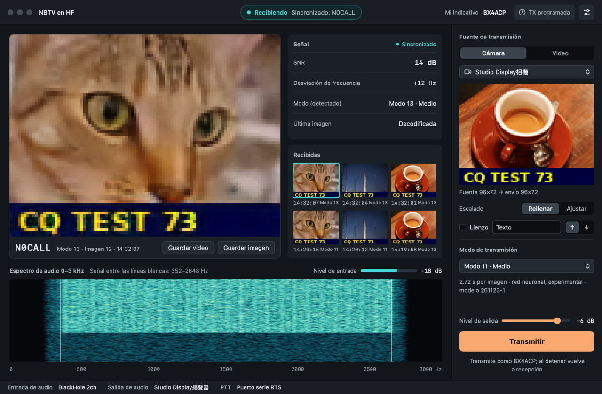
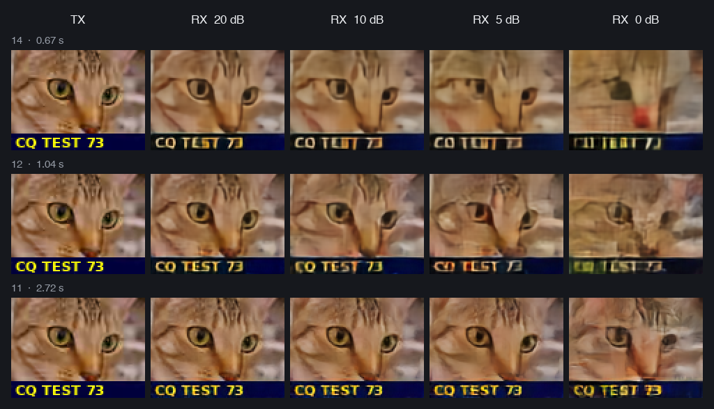
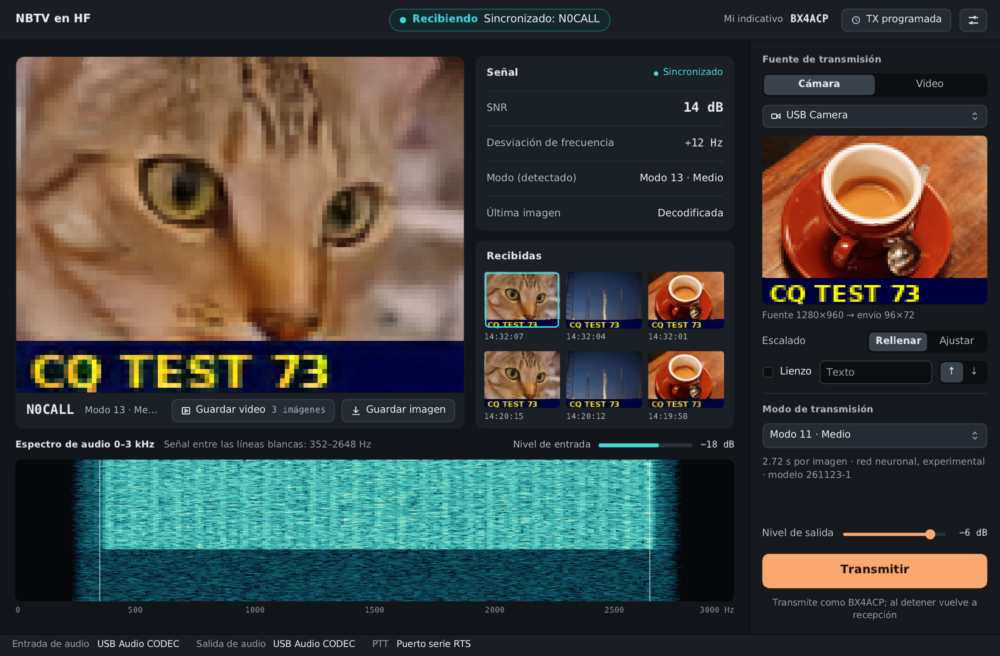

# NBeeTv

[繁體中文](README.md) · [简体中文](README.zh-CN.md) · [日本語](README.ja.md) · **Español** · [English](README.en.md)

[](https://github.com/pepefrog1234/NBeeTv/actions/workflows/build.yml)

Televisión de banda estrecha (NBTV) para radioaficionados en HF. Envía y recibe imágenes en color de 96×72 a través del audio de un equipo de SSB corriente, hasta una imagen cada 0.67 segundos.

Una red neuronal convierte cada imagen directamente en los valores que llevan las portadoras OFDM. No hay cuantización ni código corrector de errores, así que cuando la señal se debilita la imagen se vuelve más borrosa en lugar de perderse por completo.



> Todavía es experimental: la modulación, los modelos y el receptor se han validado sobre todo con simulación de canal, y las pruebas en el aire han sido pocas hasta ahora.

## Cómo se ve una imagen recibida



La columna de la izquierda (TX) es la imagen enviada. Las cuatro columnas de su derecha (RX) muestran cómo sale de un canal de HF simulado con relaciones señal/ruido de 20, 10, 5 y 0 dB.
De arriba abajo están los modos 14, 12 y 11, que tardan 0.67, 1.04 y 2.72 segundos por imagen. Un modo más lento envía más valores por imagen, así que la imagen tiene más detalle.

- El canal es el canal «pobre» (poor) del modelo de Watterson: dos trayectos de igual intensidad separados 2 ms, cada uno con su propio desvanecimiento, y una dispersión Doppler de 1 Hz. La SNR se mide en un ancho de banda de ruido de 3 kHz.
- Cada casilla es la trama de calidad mediana entre 9 enviadas seguidas, no la mejor. En el receptor estaba desactivada la combinación de las últimas tramas.
  A 0 dB no se recibieron entre 1 y 4 de las 9 tramas; la casilla muestra la mediana de las que sí llegaron.
- La figura se hizo con las herramientas de línea de comandos de los paquetes de descarga: `nbtv-tx` → `nbtv-chan` → `nbtv-rx`.

## Cómo funciona

- **Señal**: OFDM con 49 portadoras separadas 46.875 Hz, que ocupa de 352 a 2648 Hz y cabe en la banda de paso de voz de SSB.
  Cada trama es una imagen. Empieza con dos símbolos de preámbulo para la sincronización y lleva pilotos repartidos por toda la trama.
- **Codificación de la imagen**: una red convolucional convierte la imagen de 96×72 en una lista de números reales, que se envían de dos en dos como los valores I y Q de las portadoras.
  Otra red convierte los valores recibidos, junto con la SNR medida, de nuevo en una imagen. El entrenamiento ya incluía ruido, desvanecimiento y valores perdidos, así que por malos que sean los valores recibidos el resultado es solo una imagen más borrosa.
- **Cabecera**: cada trama lleva además el indicativo y un número de trama, protegidos con un código convolucional y un CRC. La imagen se puede decodificar sin la cabecera.
- **Receptor**: detecta el modo automáticamente y tolera un error de frecuencia de ±150 Hz y un error del reloj de muestreo de ±100 ppm. Cuando la señal es demasiado débil para decodificar la cabecera, sigue recibiendo al ritmo de las tramas.
  También puede combinar los valores recibidos en las últimas tramas antes de decodificar, con lo que las partes de la imagen que no han cambiado salen más nítidas. Esto ocurre solo en el receptor; el transmisor no hace nada distinto.
- **Los dos extremos necesitan el mismo modelo**: los archivos de pesos están en `models/` y vienen incluidos en los paquetes de descarga y en la app.

## Los cuatro modos

| Modo | Por imagen | Números reales por imagen | 0 dB | 10 dB | 20 dB | Notas |
| --- | --- | --- | --- | --- | --- | --- |
| 14 | 0.67 s | 1512 | 20.8 | 24.3 | 26.2 | El más rápido |
| 12 | 1.04 s | 2592 | 21.8 | 25.6 | 27.8 | |
| 11 | 2.72 s | 7776 | 24.3 | 29.2 | 32.8 | La imagen con más detalle |
| 13 | 2.72 s | 7776 | 24.4 | 29.4 | 33.1 | La misma trama que el modo 11, con una red cuatro veces mayor |

Las tres columnas numéricas son la calidad de imagen (PSNR, en dB): la media de 16 fotos que no se usaron en el entrenamiento, pasando por toda la cadena de transmisión y recepción y por el canal «pobre» simulado descrito arriba.
Los resultados con el canal de ruido blanco y con otras SNR, y cómo se midieron, están en las [notas técnicas](docs/TECHNICAL.md).

Hay además un **modo 15** experimental para canales de voz en FM de VHF/UHF: la imagen crece a 192×144 y cada una tarda 2.72 segundos.
En FM la SNR del audio es alta, y enviar una imagen más grande con la misma cantidad de valores la hace claramente más nítida;
con señal débil rinde peor que los cuatro modos de arriba, así que no es adecuado para HF. Las herramientas de línea de comandos, la app de macOS
y la app de Windows y Linux pueden enviarlo y recibirlo. Solo se ha comprobado en simulación, aún no con equipos reales.
Los detalles están en las [notas técnicas](docs/TECHNICAL.md).

También para FM hay unos **modos 5, 6 y 7** experimentales: la imagen sigue siendo de 192×144, pero la trama no lleva pilotos.
El canal de audio de FM no cambia durante una trama, así que los pilotos sobran y en el mismo tiempo cabe un 20 % más de datos.
El modo 5 usa el mismo modelo que el modo 15 y tarda 2.29 segundos por imagen; el modo 6 tarda 2.88 segundos y mejora la calidad en 1.4 dB;
el modo 7 tarda 4.43 segundos y la mejora en 3.6 dB. Solo sirven en canales de voz en FM sin desplazamiento de frecuencia y con señal estable
(no en SSB); también funcionan con las herramientas de línea de comandos y con las dos apps, y solo se han comprobado en simulación.

En el mismo tipo de trama hay además dos modos rápidos experimentales, los **modos 3 y 4**, ambos con la red cuatro veces mayor.
El modo 3 tiene una imagen de 96×72 y tarda 0.67 segundos por imagen, igual de rápido que el modo 14; al quitar los pilotos caben
2 canales más y su modelo está entrenado solo para los niveles de señal de FM, así que supera al modo 14 en 1.8 dB.
El modo 4 es una imagen grande de 192×144 a 1.01 segundos: queda 2.7 dB por debajo del modo 5, pero unos 3 dB por encima de una imagen
de 96×72 igual de rápida ampliada al mismo tamaño. El modo 4 exige unas cuatro veces más cálculo que los otros modos de imagen grande
(unos 0.13 segundos para decodificar una imagen en un M4 Max), así que una computadora lenta con pocos núcleos puede no dar abasto.
También sirven solo en FM y solo se han comprobado en simulación.

Los modos para FM (3 a 7 y 15) también pueden **llevar voz en directo junto con las imágenes** (experimental): la banda de audio del canal de voz en FM
se divide en dos, con la voz de 360 a 1220 Hz usando RADE V2 de [FreeDV](https://freedv.org) y la imagen ralentizada 1.5 veces (o 1.8 veces)
y desplazada por encima de 1335 Hz, de modo que cada imagen tarda ese tanto más. La app de macOS y la app de Windows y Linux tienen el interruptor
«Enviar voz a la vez» en la barra lateral (en las versiones posteriores a la 0.2.1); los dos extremos tienen que activarlo y elegir la misma disposición,
y con él desactivado todo funciona como antes. Solo se ha comprobado en simulación, aún no con equipos reales, y el propio RADE V2 sigue siendo
una versión preliminar que FreeDV todavía no recomienda usar en el aire. Los detalles están en las [notas técnicas](docs/TECHNICAL.md#語音與畫面共用-fm-語音通道實驗中).

## Descarga

Descarga el archivo de tu plataforma desde [Releases](https://github.com/pepefrog1234/NBeeTv/releases). Cada uno se compila y se prueba en una máquina de esa plataforma y con ese tipo de procesador.

| Plataforma | Procesador | Archivo | Contenido |
| --- | --- | --- | --- |
| macOS 14 o posterior | Chip de Apple | `NBeeTv-<versión>-macos-arm64-app.zip` | NBTV.app, la aplicación gráfica para recibir y transmitir |
| macOS 14 o posterior | Intel | `NBeeTv-<versión>-macos-x86_64-app.zip` | NBTV.app |
| macOS 11 o posterior | Chip de Apple | `NBeeTv-<versión>-macos-arm64.tar.gz` | Herramientas de línea de comandos |
| macOS 11 o posterior | Intel | `NBeeTv-<versión>-macos-x86_64.tar.gz` | Herramientas de línea de comandos |
| Linux | x86_64 | `NBeeTv-<versión>-linux-x86_64.tar.gz` | App de escritorio (`nbtv-gui`, requiere glibc 2.35 o posterior) y herramientas de línea de comandos (enlazadas estáticamente, para cualquier distribución) |
| Linux | arm64 | `NBeeTv-<versión>-linux-arm64.tar.gz` | App de escritorio y herramientas de línea de comandos (igual que arriba) |
| Windows 10, 11 | x86_64 | `NBeeTv-<versión>-windows-x86_64.zip` | App de escritorio (`nbtv-gui.exe`) y herramientas de línea de comandos |
| Windows 11 | arm64 | `NBeeTv-<versión>-windows-arm64.zip` | App de escritorio y herramientas de línea de comandos |

Todos los paquetes incluyen los archivos de pesos de todos los modos y funcionan nada más descomprimirlos. Las compilaciones de versiones aún no publicadas se pueden descargar de los Artifacts de cada ejecución en [Actions](https://github.com/pepefrog1234/NBeeTv/actions/workflows/build.yml) (hay que iniciar sesión en GitHub; se conservan 7 días).

### La app de macOS

NBTV.app no está firmada con un certificado de desarrollador de Apple ni notarizada; solo tiene una firma ad-hoc. Por eso macOS la bloquea la primera vez que la abres después de descargarla.
Cuando estés seguro de que el archivo viene de este repositorio, permítela de una de estas dos formas:

- Ábrela una vez (se bloqueará) y luego ve a Ajustes del Sistema → Privacidad y seguridad, baja hasta el final y haz clic en «Abrir igualmente» (en algunas variantes del español del sistema: Configuración del Sistema y «Abrir de todos modos»); o
- Ejecuta `xattr -dr com.apple.quarantine /Applications/NBTV.app` en Terminal (usa la ruta donde hayas puesto la app).

Primer uso:

1. Haz clic en el botón de ajustes de arriba a la derecha (o pulsa ⌘,). Escribe tu indicativo, elige los dispositivos de entrada y salida de audio y elige cómo se acciona el PTT:
   sin control (se usa el VOX del equipo), RTS o DTR de un puerto serie, comandos CAT o un rigctld que ya esté en marcha. Los dos últimos necesitan tener [Hamlib](https://github.com/Hamlib/Hamlib) instalado aparte.
2. macOS pide acceso al micrófono (la recepción lee del dispositivo de entrada de audio) y, si eliges la cámara como fuente de transmisión, acceso a la cámara.
3. Al volver a la ventana principal ya está recibiendo. Elige la fuente de transmisión (cámara, archivo de video o una serie de imágenes) y el modo de transmisión en la barra lateral y haz clic en «Transmitir».

La app también puede transmitir a horas programadas, imprimir una línea de texto sobre la imagen (Lienzo) y guardar las imágenes recibidas como imagen o como video. La interfaz está en chino tradicional, chino simplificado, japonés, español e inglés, y sigue el idioma del sistema.
La guía completa está en [apps/macos/README.md](apps/macos/README.md).

### La app de Windows y Linux

Los paquetes de Windows y Linux incluyen `nbtv-gui` (`nbtv-gui.exe` en Windows): la interfaz gráfica de la app de macOS llevada a estos sistemas, con la misma disposición y el mismo comportamiento al recibir y transmitir. Se ejecuta nada más descomprimir; tiene que quedarse en la misma carpeta que `models/`.



*Esta imagen la generó el propio programa en Linux, sin abrir ninguna ventana, a partir de datos de demostración.*

- **Windows**: el ejecutable no tiene firma de código, así que SmartScreen puede bloquearlo la primera vez. Cuando estés seguro de que el archivo viene de este repositorio, pulsa «Más información → Ejecutar de todas formas».
- **Linux**: requiere glibc 2.35 o posterior (Ubuntu 22.04, Debian 12, Raspberry Pi OS bookworm y posteriores). El texto en chino y japonés de la interfaz necesita fuentes del sistema (por ejemplo `fonts-noto-cjk`); sin ellas, la interfaz se muestra en inglés.
- Para usar un archivo de video como fuente de transmisión y para guardar como video las imágenes recibidas se usa [ffmpeg](https://ffmpeg.org): el paquete de Windows ya lo incluye (`ffmpeg.exe`), así que no hay que instalarlo; en Linux hay que instalarlo aparte (por ejemplo, `sudo apt install ffmpeg`). Las imágenes y las series de imágenes no lo necesitan. Para controlar el PTT con comandos CAT hay que instalar [Hamlib](https://github.com/Hamlib/Hamlib).

> Esta app es nueva. Tiene comprobaciones automáticas completas en CI, pero **todavía nadie la ha usado en una computadora real con Windows o Linux conectada a un equipo de radio**: las tarjetas de sonido, las cámaras y el PTT por puerto serie no se han verificado con hardware de verdad. Antes de confiar en ella, lee «驗證過與還沒驗證的» (lo que se ha verificado y lo que no) en [apps/desktop/README.md](apps/desktop/README.md) (en chino tradicional), y por favor avisa de los problemas en Issues.

### Herramientas de línea de comandos

Todos los paquetes incluyen las herramientas de línea de comandos. Trabajan con archivos, no en directo: para transmitir se reproduce en el equipo el archivo WAV generado; para recibir se graba el audio del equipo en un archivo WAV y se decodifica.

Al descomprimir el paquete, los ejecutables y `models/` quedan en la misma carpeta y se pueden usar ahí mismo. Las imágenes son siempre archivos PPM binarios de 96×72 (192×144 para los modos 4 a 7 y 15), que se pueden generar con ffmpeg (el paquete de Windows incluye `ffmpeg.exe`).

```sh
# Convertir una foto en un PPM de 96×72
ffmpeg -i photo.jpg -vf scale=96:72 -pix_fmt rgb24 photo.ppm

# Crear un WAV para reproducirlo directamente en el equipo (--mode va de 11 a 15, --call es tu indicativo)
./nbtv-tx --mode 14 --call N0CALL --out tx.wav photo.ppm

# Decodificar una grabación en imágenes: received/frame_0.ppm, frame_1.ppm, ... (--merge: combina las últimas tramas antes de decodificar)
mkdir received
./nbtv-rx --merge --out-dir received recording.wav

# Probar sin equipo: pasar tx.wav por un canal de HF simulado y decodificarlo
./nbtv-chan --channel poor --snr 10 tx.wav rx.wav
./nbtv-rx --out-dir received rx.wav
```

- En Windows, usa `.\nbtv-tx.exe` en lugar de `./nbtv-tx`, y lo mismo con las demás herramientas.
- En macOS, si las herramientas quedan bloqueadas, ejecuta antes `xattr -dr com.apple.quarantine <carpeta>` sobre la carpeta descomprimida.
- Las grabaciones deben ser archivos WAV de 12000 o 48000 Hz, PCM de 16 bits o coma flotante de 32 bits. Si hay más de un canal, se usa el primero.

| Herramienta | Para qué sirve |
| --- | --- |
| `nbtv-tx` | Imágenes → un WAV para reproducir en el equipo |
| `nbtv-rx` | WAV → las imágenes recibidas; `--json` da una salida pensada para otros programas |
| `nbtv-chan` | Pasa un WAV por un canal de HF simulado (desvanecimiento, ruido, desplazamiento de frecuencia, error del reloj de muestreo) |
| `nbtv-sim` | Repite muchas veces transmisión → canal → recepción e informa de cuántas tramas llegan y con qué calidad |
| `nbtv-learned` | Prueba solo el modelo que convierte una imagen en valores del canal y viceversa, sin el módem |

Cada herramienta muestra todas sus opciones con `--help` (por ahora el texto de ayuda solo está en chino tradicional).

## Tarjeta de recepción

La estación del autor, **BX4ACP**, transmite esta señal. Graba el audio de tu equipo en un archivo WAV y súbelo a <https://nbeetv.yakumo.tw>.
Si se decodifican más de 10 imágenes y también el indicativo, el sitio te emite una tarjeta de recepción con firma digital. No hace falta iniciar sesión, y la grabación puede durar hasta 5 minutos.

El código de ese sitio también está en este repositorio ([apps/web/](apps/web/README.md)), así que puedes montar uno para tu propia estación.

## Antes de conectar un equipo

- Usa USB (o un modo de datos) en los dos extremos. Los filtros de transmisión y de recepción deben cubrir de 352 a 2648 Hz; si son más estrechos, recortan las portadoras de los bordes.
- Los dos equipos deben estar a menos de ±150 Hz uno del otro.
- Desactiva todo lo que altere la forma de onda: el compresor de voz y el ecualizador en transmisión, y la reducción de ruido (NR) y el notch automático en recepción.
- OFDM tiene picos muy por encima de su nivel medio. Baja el nivel de salida hasta que el ALC deje de actuar; la potencia media quedará bastante por debajo de la potencia nominal del equipo, y eso es normal.
- Antes de transmitir, comprueba que la normativa de tu país permite este tipo de emisión.

## Compilar desde el código fuente

Hace falta CMake 3.20 o posterior y un compilador de C++20 (sirven GCC, el clang de Xcode y el MSVC de Visual Studio). El núcleo no necesita ninguna otra biblioteca.

```sh
git clone https://github.com/pepefrog1234/NBeeTv.git
cd NBeeTv
cmake -S . -B build
cmake --build build --config Release
ctest --test-dir build -C Release --output-on-failure
```

Las herramientas quedan en `build/tools/` (`build/tools/Release/` con Visual Studio). Las pruebas usan los archivos de pesos de `models/` y tardan unos minutos.

La app de macOS usa otro directorio de compilación y necesita Xcode y Ninja:

```sh
cmake -S . -B build-app -G Ninja -DNBTV_BUILD_MACOS_APP=ON -DNBTV_BUILD_TESTS=OFF -DNBTV_BUILD_TOOLS=OFF
cmake --build build-app
open build-app/apps/macos/NBTV.app
```

La app de Windows y Linux (al configurar se descargan SDL, Dear ImGui y stb; los paquetes que Linux necesita antes están en [apps/desktop/README.md](apps/desktop/README.md)):

```sh
cmake -S . -B build-desktop -DNBTV_BUILD_DESKTOP_APP=ON -DNBTV_BUILD_TESTS=OFF
cmake --build build-desktop --config Release --target nbtv-gui
```

El códec de voz que usa «Enviar voz a la vez» no se compila por defecto (los programas de los paquetes de descarga posteriores a la 0.2.1 sí lo llevan). Para incluirlo,
añade `-DNBTV_VOICE=ON` a cualquiera de las líneas `cmake -S …` de arriba: al configurar se descargan además el código fuente de
[rade_c](https://github.com/freedv/rade_c) y de [Opus](https://github.com/xiph/opus) y los datos de los modelos de Opus (unos 280 MB en total,
cada uno comprobado con su SHA-256) y se compilan junto con el proyecto; no hay que instalar nada más.

| Ruta | Contenido |
| --- | --- |
| `core/` | Biblioteca principal en C++20, independiente de la plataforma: transmisión y recepción OFDM, sincronización, estimación de canal e inferencia de la red neuronal. Su única interfaz pública es una API en C (`core/include/nbtv/nbtv.h`) |
| `sim/` | Simulación del canal de HF |
| `voice/` | Envoltorio del códec de voz en tiempo real (RADE V2 de FreeDV) para «Enviar voz a la vez»; opcional |
| `tools/` | Herramientas de línea de comandos; `tools/learned/` contiene el código de entrenamiento y exportación de los modelos (Python, PyTorch) |
| `models/` | Archivos de pesos de los modelos |
| `apps/macos/` | La app de macOS (SwiftUI) |
| `apps/desktop/` | La app de Windows y Linux (C++, SDL 3, Dear ImGui) |
| `apps/web/` | El sitio web de las tarjetas de recepción (Python, FastAPI) |

## Limitaciones actuales

- El texto y los subtítulos salen emborronados, y las zonas pequeñas de color vivo pierden intensidad.
- Nada autentica una trama ni su indicativo: cualquiera puede enviar imágenes con cualquier indicativo.
- La app de Windows y Linux es nueva y solo se ha comprobado con pruebas automáticas; todavía no se ha verificado con una radio, una tarjeta de sonido, una cámara ni un puerto serie reales.
- «Enviar voz a la vez» solo se ha comprobado en simulación. RADE V2 sigue siendo una versión preliminar: su forma de onda puede cambiar, y las versiones de antes y de después de un cambio así no se oyen entre sí.
- El texto de ayuda de las herramientas de línea de comandos y los documentos detallados de abajo solo están en chino tradicional por ahora.

## Documentación

Estos documentos están en chino tradicional.

- [Notas técnicas](docs/TECHNICAL.md): resultados de simulación, comportamiento del receptor, estructura de la trama y decisiones de diseño, y lo que falta por hacer
- [La app de macOS](apps/macos/README.md)
- [La app de Windows y Linux](apps/desktop/README.md)
- [Modelos y entrenamiento](tools/learned/README.md)
- [El sitio web de las tarjetas de recepción](apps/web/README.md)
- [Borrador de especificación v0.1](短波%20NBTV%20軟體規格草案%20v0.1.md): escrito antes de pasar a la codificación con red neuronal; siguen siendo válidas las partes sobre los parámetros OFDM, el preámbulo y los pilotos

## Licencia

El código se publica bajo la [Licencia Pública General de GNU, versión 3 (GPL-3.0)](LICENSE).

Los pesos de los modelos (`models/`) se entrenaron con fotos de [COCO](https://cocodataset.org/) val2017. Los derechos de autor de esas fotos pertenecen a sus fotógrafos, que las publicaron con distintas licencias Creative Commons, algunas de las cuales solo permiten el uso no comercial.
Los pesos se ofrecen junto con el proyecto. Antes de usarlos para algo que no sean experimentos de radioafición, comprueba por tu cuenta que ese uso está permitido.

Los programas de los paquetes de descarga posteriores a la 0.2.1 están enlazados además con [rade_c](https://github.com/freedv/rade_c) (BSD de 2 cláusulas) y [Opus](https://github.com/xiph/opus) (BSD de 3 cláusulas), que usa «Enviar voz a la vez».
Los textos de sus licencias están en `THIRD-PARTY-LICENSES.txt` dentro de cada paquete (en `Resources` dentro de la app de macOS) y en [voice/LICENSES/](voice/LICENSES/) en el repositorio.
