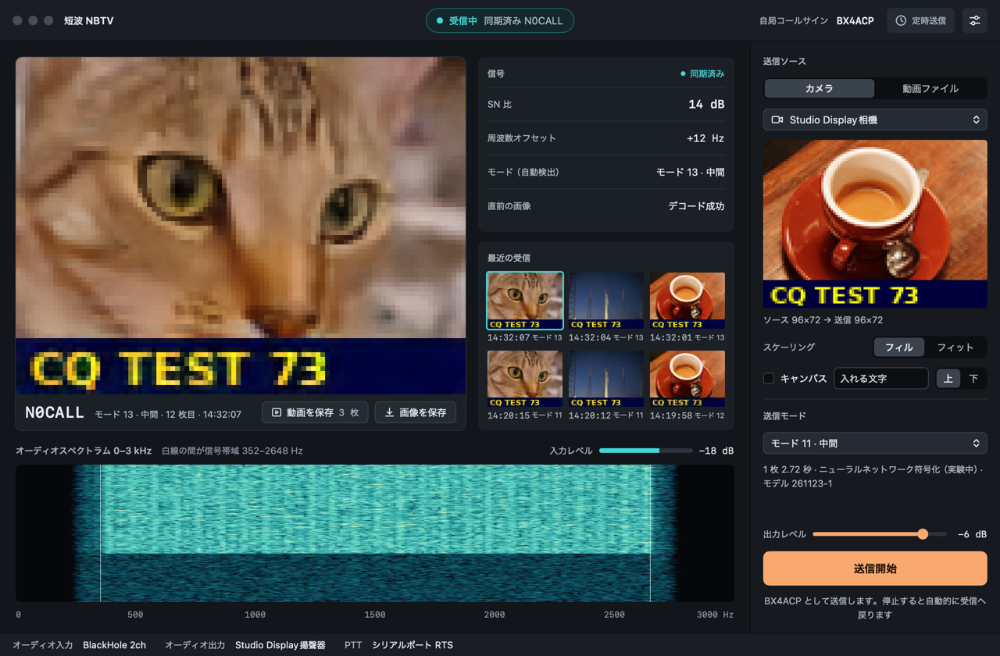
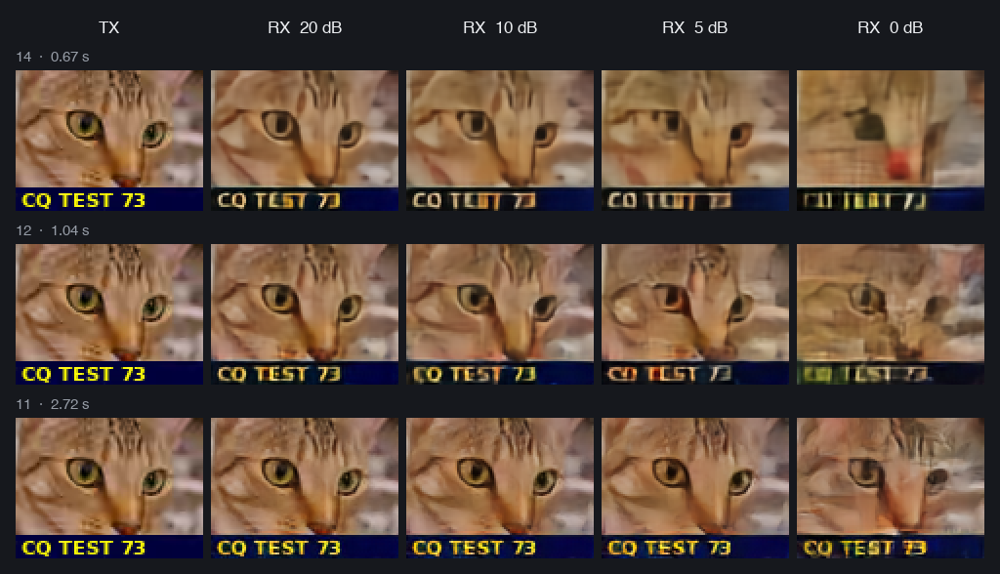
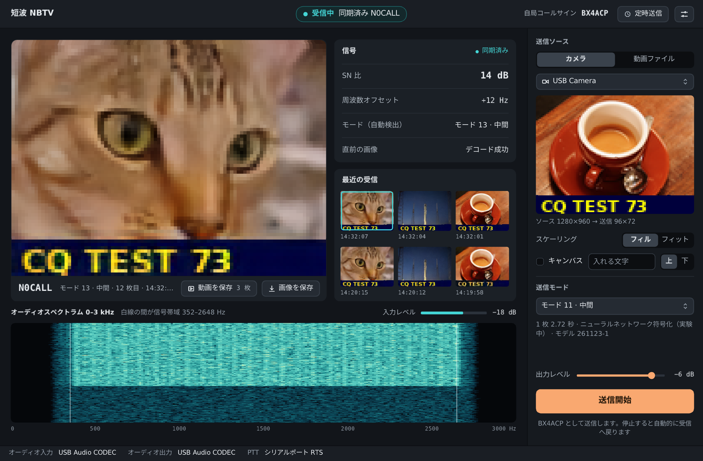

# NBeeTv

[繁體中文](README.md) · [简体中文](README.zh-CN.md) · **日本語** · [Español](README.es.md) · [English](README.en.md)

[](https://github.com/pepefrog1234/NBeeTv/actions/workflows/build.yml)

短波（HF）のアマチュア無線用の狭帯域テレビ（NBTV）ソフトウェアです。一般的な SSB 無線機のオーディオを通して、96×72 のカラー画像を送受信します。最速で 0.67 秒に 1 枚です。

画像はニューラルネットワークによって、OFDM のキャリアに載せる値へ直接変換されます。量子化も誤り訂正符号もないため、信号が弱くなっても画像が少しずつぼやけるだけで、まったく受信できなくなることはありません。



> まだ実験段階です。変調方式、モデル、受信機の検証は主に伝搬路のシミュレーションによるもので、実機でのテストはまだ多くありません。

## 受信した画像の見え方



左端の列（TX）が送信した画像です。右の 4 列（RX）は、シミュレーションした短波の伝搬路を通したあと、SN 比 20、10、5、0 dB で受信した結果です。
上から順にモード 14、12、11 で、1 枚あたり 0.67 秒、1.04 秒、2.72 秒かかります。遅いモードほど 1 枚の画像で送る値が多く、画像が細かくなります。

- 伝搬路は Watterson モデルの「poor」チャネルです。強さの等しい 2 つのパスが 2 ms 離れていて、それぞれ別々にフェージングし、ドップラースプレッドは 1 Hz です。SN 比は 3 kHz の雑音帯域幅で計算しています。
- 各マスは、連続して送った 9 枚のうち画質が中央のものです。いちばん良いものを選んだわけではありません。受信側の「最近のフレームの合成」はオフです。
  0 dB では 9 枚のうち 1〜4 枚が受信できず、図には受信できたものの中で中央の 1 枚を載せています。
- この図は、ダウンロードパッケージに入っているコマンドラインツールで作りました：`nbtv-tx` → `nbtv-chan` → `nbtv-rx`。

## しくみ

- **信号**：OFDM で、キャリアは 49 本、間隔は 46.875 Hz、占有帯域は 352〜2648 Hz です。SSB の音声通過帯域に収まります。
  1 フレームが 1 枚の画像です。先頭に同期用のプリアンブルシンボルが 2 つあり、途中にパイロットが散りばめられています。
- **画像の符号化**：畳み込みネットワークが 96×72 の画像を実数の列に変換し、2 つずつ組にして、キャリアの I・Q の値としてそのまま送ります。
  もう一方のネットワークが、受信した値と測定した SN 比から画像を復元します。学習の段階で雑音、フェージング、値の欠落を加えているので、受信した値がどれほど悪くても、得られるのは少しぼやけた画像です。
- **ヘッダー**：各フレームにはコールサインとフレーム番号も入っていて、畳み込み符号と CRC で保護されています。画像はヘッダーがなくても復元できます。
- **受信機**：モードは自動で判別します。±150 Hz の周波数誤差と ±100 ppm のサンプリングクロック誤差を許容します。信号が弱くてヘッダーを復号できないときも、フレームの周期に合わせて受信を続けます。
  直近の数フレームで受信した値を合成してから復号することもでき、画像の変化していない部分がより鮮明になります。これは受信側だけの処理で、送信側は何もする必要がありません。
- **送受信の双方で同じモデルが必要です**：重みファイルは `models/` にあり、ダウンロードパッケージとアプリに同梱されています。

## 4 つのモード

| モード | 1 枚あたり | 1 枚で送る実数の数 | 0 dB | 10 dB | 20 dB | 説明 |
| --- | --- | --- | --- | --- | --- | --- |
| 14 | 0.67 秒 | 1512 | 20.8 | 24.3 | 26.2 | 最速 |
| 12 | 1.04 秒 | 2592 | 21.8 | 25.6 | 27.8 | |
| 11 | 2.72 秒 | 7776 | 24.3 | 29.2 | 32.8 | 画像が最も細かい |
| 13 | 2.72 秒 | 7776 | 24.4 | 29.4 | 33.1 | フレームはモード 11 と同じで、ネットワークが 4 倍の大きさ |

数値の 3 列は画質（PSNR、dB）です。学習に使っていない写真 16 枚の平均で、送受信の全過程と、上で述べたシミュレーションの「poor」チャネルを通した結果です。
白色雑音のチャネル、その他の SN 比、測定方法は[技術解説](docs/TECHNICAL.md)にあります。

このほかに、VHF／UHF の FM 音声チャネル向けの実験的な**モード 15** があります。画像を 192×144 に大きくしたもので、1 枚 2.72 秒です。
FM はオーディオの SN 比が高いので、同じ数の値で大きな画像を送ると、はっきり鮮明になります。信号が弱いときは上の 4 つのモードより劣るため、
短波には向きません。コマンドラインツール、macOS のアプリ、Windows と Linux のアプリのいずれでも送受信できます。
シミュレーションで確認しただけで、実際の無線機ではまだ試していません。詳しくは[技術解説](docs/TECHNICAL.md)をご覧ください。

FM 向けにはさらに、実験的な**モード 5、6、7** があります。画像は同じ 192×144 ですが、フレームにパイロットがありません。
FM のオーディオチャネルは 1 フレームの間に変化しないのでパイロットを省くことができ、同じ時間で 2 割多くのデータを送れます。
モード 5 はモード 15 と同じモデルを使い、1 枚 2.29 秒です。モード 6 は 1 枚 2.88 秒で画質が 1.4 dB 高く、モード 7 は 1 枚 4.43 秒で 3.6 dB 高くなります。
周波数ずれがなく信号が安定した FM 音声チャネルでしか使えません（SSB では使えません）。
こちらもコマンドラインツールと 2 つのアプリのどれでも使えますが、シミュレーションで確認しただけです。

同じ種類のフレームには、実験的な高速のモードが 2 つあります（**モード 3、4**）。どちらも 4 倍大きいネットワークを使います。
モード 3 は画像が 96×72、1 枚 0.67 秒で、モード 14 と同じ速さです。パイロットを省いた分でチャネルを 2 つ増やし、
モデルも FM の SN 比だけで学習しているので、画質はモード 14 より 1.8 dB 高くなります。モード 4 は 192×144 の大画面で 1 枚 1.01 秒です。
モード 5 より 2.7 dB 低いものの、同じ速さの 96×72 の画像を拡大したものより約 3 dB 高くなります。
モード 4 の計算量はほかの大画面モードの約 4 倍で（M4 Max で 1 枚の復号に約 0.13 秒）、コアの少ない遅いコンピュータでは追いつかないことがあります。
これらも FM でしか使えず、シミュレーションで確認しただけです。

## ダウンロード

[Releases](https://github.com/pepefrog1234/NBeeTv/releases) から、お使いのプラットフォーム用のファイルをダウンロードしてください。どれも、そのプラットフォーム・そのプロセッサのマシン上でビルドし、テストを通したものです。

| プラットフォーム | プロセッサ | ファイル | 内容 |
| --- | --- | --- | --- |
| macOS 14 以降 | Apple シリコン | `NBeeTv-<バージョン>-macos-arm64-app.zip` | NBTV.app：送受信用の GUI アプリ |
| macOS 14 以降 | Intel | `NBeeTv-<バージョン>-macos-x86_64-app.zip` | NBTV.app |
| macOS 11 以降 | Apple シリコン | `NBeeTv-<バージョン>-macos-arm64.tar.gz` | コマンドラインツール |
| macOS 11 以降 | Intel | `NBeeTv-<バージョン>-macos-x86_64.tar.gz` | コマンドラインツール |
| Linux | x86_64 | `NBeeTv-<バージョン>-linux-x86_64.tar.gz` | デスクトップアプリ（`nbtv-gui`、glibc 2.35 以降が必要）とコマンドラインツール（静的リンク、ディストリビューションを問いません） |
| Linux | arm64 | `NBeeTv-<バージョン>-linux-arm64.tar.gz` | デスクトップアプリとコマンドラインツール（同上） |
| Windows 10、11 | x86_64 | `NBeeTv-<バージョン>-windows-x86_64.zip` | デスクトップアプリ（`nbtv-gui.exe`）とコマンドラインツール |
| Windows 11 | arm64 | `NBeeTv-<バージョン>-windows-arm64.zip` | デスクトップアプリとコマンドラインツール |

どのパッケージにも各モードの重みファイルが入っていて、展開すればすぐに使えます。まだリリースされていない版は、[Actions](https://github.com/pepefrog1234/NBeeTv/actions/workflows/build.yml) の各ビルドの Artifacts からダウンロードできます（GitHub へのサインインが必要で、保存期間は 7 日です）。

### macOS のアプリ

NBTV.app には Apple の開発者署名も公証もなく、ad-hoc 署名だけです。そのため、ダウンロード後に初めて開くときに macOS にブロックされます。
このリポジトリからダウンロードしたファイルであることを確かめたうえで、次のどちらかの方法で許可してください。

- 一度開いて（ブロックされます）から、「システム設定」→「プライバシーとセキュリティ」のいちばん下で「このまま開く」をクリックする。
- ターミナルで `xattr -dr com.apple.quarantine /Applications/NBTV.app` を実行する（パスはアプリを置いた場所に合わせてください）。

初めて使うとき：

1. 右上の設定ボタン（または ⌘,）を押し、コールサインを入力して、オーディオの入力・出力デバイスと PTT の制御方法を選びます。
   制御しない（無線機の VOX を使う）、シリアルポートの RTS／DTR、CAT コマンド、すでに起動している rigctld への接続から選べます。あとの 2 つには [Hamlib](https://github.com/Hamlib/Hamlib) を別途インストールする必要があります。
2. マイクへのアクセス許可を求められます（受信はオーディオ入力デバイスから音を取り込みます）。送信ソースにカメラを選ぶと、カメラへのアクセス許可も求められます。
3. メインウインドウに戻ると、すでに受信が始まっています。右のサイドバーで送信ソース（カメラ、動画ファイル、または順番に送る複数の画像）と送信モードを選び、「送信開始」を押します。

このほかに、定時送信、画像に 1 行の文字を入れる機能（キャンバス）、受信した画像を画像ファイルや動画として保存する機能があります。インターフェイスは繁体字中国語、簡体字中国語、日本語、スペイン語、英語に対応していて、システムの言語に合わせて自動で切り替わります。
詳しい説明は [apps/macos/README.md](apps/macos/README.md) にあります。

### Windows と Linux のアプリ

Windows と Linux のパッケージには `nbtv-gui`（Windows では `nbtv-gui.exe`）が入っています。macOS のアプリを移植した GUI で、画面の構成も送受信の動作も同じです。展開したらそのまま実行できます。`models/` と同じフォルダに置いたままにしてください。



*この画像は、プログラム自身が Linux 上でウインドウを開かずに、デモ用のデータから描画したものです。*

- **Windows**：実行ファイルにはコード署名がないため、初回の実行時に SmartScreen に止められることがあります。このリポジトリからダウンロードしたファイルであることを確認したうえで、「詳細情報 → 実行」を押してください。
- **Linux**：glibc 2.35 以降が必要です（Ubuntu 22.04、Debian 12、Raspberry Pi OS bookworm 以降）。日本語や中国語の表示にはシステムのフォント（`fonts-noto-cjk` など）を使い、見つからない場合は英語で表示します。
- 動画ファイルを送信ソースにする機能と、受信した画像を動画として保存する機能には [ffmpeg](https://ffmpeg.org) のインストールが必要です（画像ファイルや、順番に送る複数の画像には不要です）。CAT コマンドで PTT を制御するには [Hamlib](https://github.com/Hamlib/Hamlib) が必要です。

> このアプリは新しいものです。CI で自動チェックを一通り行っていますが、**実際の Windows や Linux のパソコンを無線機につないで使った人はまだいません**。実物のサウンドデバイス、カメラ、シリアルポートによる PTT は、実機ではまだ確認できていません。使う前に [apps/desktop/README.md](apps/desktop/README.md)（繁体字中国語）の「驗證過與還沒驗證的」（確認できたこと・できていないこと）を読んでください。問題があれば Issues で知らせてください。

### コマンドラインツール

どのパッケージにもコマンドラインツールが入っています。扱うのはファイルで、リアルタイムの送受信ではありません。送信するときは作成した WAV ファイルを無線機に向けて再生し、受信するときは無線機の音を WAV ファイルに録音してから復号します。

展開すると、実行ファイルと `models/` が同じフォルダに入っているので、そのまま実行できます。画像はすべて 96×72 のバイナリ PPM（モード 4〜7 と 15 は 192×144）で、ffmpeg で変換できます。

```sh
# 写真を 96×72 の PPM に変換する
ffmpeg -i photo.jpg -vf scale=96:72 -pix_fmt rgb24 photo.ppm

# 無線機にそのまま流せる WAV を作る（--mode は 11〜15、--call は自分のコールサイン）
./nbtv-tx --mode 14 --call N0CALL --out tx.wav photo.ppm

# 録音を画像に戻し、received/frame_0.ppm、frame_1.ppm… として保存する（--merge：直近の数フレームを合成して復号）
mkdir received
./nbtv-rx --merge --out-dir received recording.wav

# 無線機なしで試す：tx.wav をシミュレーションした短波の伝搬路に通してから復号する
./nbtv-chan --channel poor --snr 10 tx.wav rx.wav
./nbtv-rx --out-dir received rx.wav
```

- Windows では `./nbtv-tx` を `.\nbtv-tx.exe` に置き換えてください。ほかのツールも同じです。
- macOS でブロックされた場合は、展開したフォルダに対して先に `xattr -dr com.apple.quarantine <フォルダ>` を実行してください。
- 録音は 12000 Hz または 48000 Hz の WAV で、16 ビット PCM か 32 ビット浮動小数点にしてください。複数チャンネルの場合は最初のチャンネルを使います。

| ツール | 用途 |
| --- | --- |
| `nbtv-tx` | 画像 → 無線機に流す WAV |
| `nbtv-rx` | WAV → 受信した画像。`--json` はプログラムで読むための出力です |
| `nbtv-chan` | WAV をシミュレーションした短波の伝搬路（フェージング、雑音、周波数オフセット、サンプリングクロック誤差）に通す |
| `nbtv-sim` | 送信 → 伝搬路 → 受信を何度も繰り返し、受信できたフレーム数と画質を集計する |
| `nbtv-learned` | モデムを通さず、「画像 ↔ 伝搬路上の値」のモデルだけを試す |

各ツールに `--help` を付けると、すべてのオプションが表示されます（説明文は今のところ繁体字中国語のみです）。

## 受信カード

作者の局 **BX4ACP** がこの信号を送信しています。お使いの無線機で受信した音を WAV ファイルに録音し、<https://nbeetv.yakumo.tw> にアップロードしてください。
10 枚を超える画像が復元され、コールサインも復号できれば、電子署名付きの受信カードが発行されます。ログインは不要で、録音は最長 5 分です。

このサイトのプログラムもこのリポジトリにあり（[apps/web/](apps/web/README.md)）、自分の局用に立てることができます。

## 無線機につなぐ前に

- 送受信の双方で USB（またはデータモード）を使います。送信・受信のフィルターはどちらも 352〜2648 Hz を通す必要があり、それより狭いと端のキャリアが削られます。
- 2 台の無線機の周波数差は ±150 Hz 以内にしてください。
- 波形を変えてしまう処理はオフにします。送信側のスピーチコンプレッサーとイコライザー、受信側のノイズリダクション（NR）とオートノッチです。
- OFDM はピークが平均よりずっと高くなります。ALC が動作しなくなるまで出力レベルを下げてください。平均電力は定格出力よりかなり低くなりますが、それで正常です。
- 送信する前に、お住まいの国や地域の法令でこの方式の送信が認められていることを確認してください。

## ソースからビルドする

CMake 3.20 以降と、C++20 に対応したコンパイラが必要です（GCC、Xcode の clang、Visual Studio の MSVC のいずれも使えます）。コアはほかのライブラリを必要としません。

```sh
git clone https://github.com/pepefrog1234/NBeeTv.git
cd NBeeTv
cmake -S . -B build
cmake --build build --config Release
ctest --test-dir build -C Release --output-on-failure
```

ツールは `build/tools/`（Visual Studio の場合は `build/tools/Release/`）にできます。テストは `models/` の重みファイルを使い、すべて終わるまで数分かかります。

macOS のアプリは別のビルドディレクトリを使い、Xcode と Ninja が必要です。

```sh
cmake -S . -B build-app -G Ninja -DNBTV_BUILD_MACOS_APP=ON -DNBTV_BUILD_TESTS=OFF -DNBTV_BUILD_TOOLS=OFF
cmake --build build-app
open build-app/apps/macos/NBTV.app
```

Windows と Linux のアプリ（設定時に SDL、Dear ImGui、stb をダウンロードします。Linux で先に入れておくパッケージは [apps/desktop/README.md](apps/desktop/README.md) にあります）：

```sh
cmake -S . -B build-desktop -DNBTV_BUILD_DESKTOP_APP=ON -DNBTV_BUILD_TESTS=OFF
cmake --build build-desktop --config Release --target nbtv-gui
```

| パス | 内容 |
| --- | --- |
| `core/` | プラットフォームに依存しない C++20 のコアライブラリ：OFDM の送受信、同期、伝搬路推定、ニューラルネットワークの推論。外部に公開しているのは C API ひとつだけです（`core/include/nbtv/nbtv.h`） |
| `sim/` | 短波の伝搬路シミュレーション |
| `tools/` | コマンドラインツール。`tools/learned/` はモデルの学習とエクスポート用のプログラムです（Python、PyTorch） |
| `models/` | モデルの重みファイル |
| `apps/macos/` | macOS のアプリ（SwiftUI） |
| `apps/desktop/` | Windows と Linux のアプリ（C++、SDL 3、Dear ImGui） |
| `apps/web/` | 受信カードのウェブサイト（Python、FastAPI） |

## 現在の制限

- 文字や字幕はにじんで読みにくくなり、小さな範囲の鮮やかな色は薄くなります。
- フレームやコールサインには身元を確認するしくみがなく、だれでも任意のコールサインで画像を送れます。
- Windows と Linux のアプリは新しく、自動テストでしか確認していません。実物の無線機、サウンドデバイス、カメラ、シリアルポートではまだ検証できていません。
- コマンドラインツールの説明文と下記の詳細なドキュメントは、今のところ繁体字中国語のみです。

## ドキュメント

以下のドキュメントは繁体字中国語です。

- [技術解説](docs/TECHNICAL.md)：シミュレーション結果、受信機の動作、フレーム構造と設計上の判断、まだできていないこと
- [macOS のアプリ](apps/macos/README.md)
- [Windows と Linux のアプリ](apps/desktop/README.md)
- [モデルと学習](tools/learned/README.md)
- [受信カードのウェブサイト](apps/web/README.md)
- [仕様の草案 v0.1](短波%20NBTV%20軟體規格草案%20v0.1.md)：ニューラルネットワークに切り替える前に書かれたものです。OFDM のパラメーター、プリアンブル、パイロットの部分は今も有効です

## ライセンス

コードは [GNU General Public License バージョン 3（GPL-3.0）](LICENSE) で公開しています。

モデルの重み（`models/`）は [COCO](https://cocodataset.org/) val2017 の写真で学習したものです。写真の著作権はそれぞれの撮影者にあり、さまざまなクリエイティブ・コモンズ・ライセンスで公開されていて、非営利の利用に限るものも含まれます。
重みはプロジェクトと一緒に提供しています。アマチュア無線の実験以外の用途で使う場合は、利用できるかどうかをご自身で確認してください。
