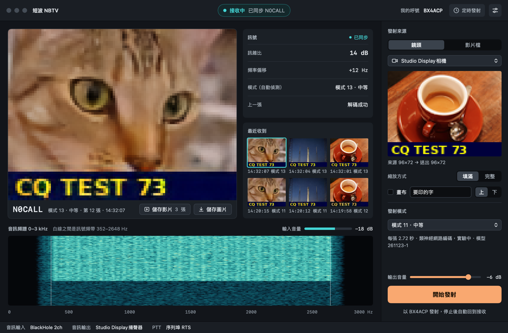
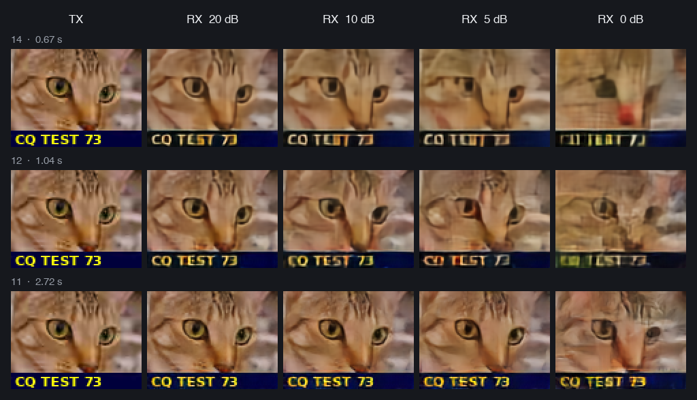
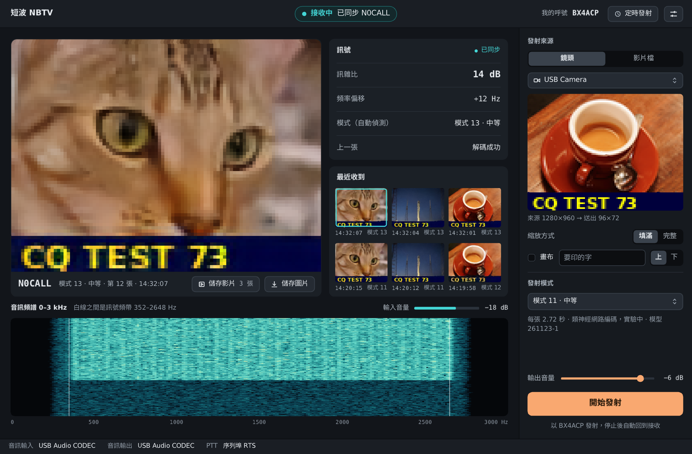

# NBeeTv

**繁體中文** · [简体中文](README.zh-CN.md) · [日本語](README.ja.md) · [Español](README.es.md) · [English](README.en.md)

[](https://github.com/pepefrog1234/NBeeTv/actions/workflows/build.yml)

短波業餘無線電用的窄頻電視（NBTV）軟體：透過一般 SSB 電台的音訊，收發 96×72 的彩色畫面，最快每 0.67 秒一張。

畫面由類神經網路直接變成 OFDM 載波上的值，沒有量化，也沒有糾錯碼。訊號變弱時畫面是慢慢變糊，而不是整張收不到。



> 還在實驗階段：調變、模型與接收機主要是用通道模擬驗證的，實機的測試還不多。

## 收到的畫面長什麼樣子



最左邊一欄（TX）是送出去的畫面，右邊四欄（RX）是它經過模擬的短波通道之後，在訊雜比 20、10、5、0 dB 時收到的樣子。
由上到下是模式 14、12、11，每張畫面分別花 0.67、1.04、2.72 秒：愈慢的模式一張畫面送的值愈多，畫面愈細。

- 通道是 Watterson 模型的「差」通道：兩條等強的路徑相隔 2 ms，各自衰落，都卜勒擴散 1 Hz。訊雜比以 3 kHz 的雜訊頻寬計。
- 每一格是連續送 9 張之中畫質居中的那一張，不是挑最好的；接收端沒有開「合併最近幾幀」。
  0 dB 時 9 張裡有 1 到 4 張沒有收到，圖上是收到的那幾張裡居中的一張。
- 這張圖是用下載包裡的命令列工具做的：`nbtv-tx` → `nbtv-chan` → `nbtv-rx`。

## 它是怎麼運作的

- **訊號**：OFDM，49 個載波、間隔 46.875 Hz，佔 352–2648 Hz，放得進 SSB 的語音通帶。
  每一幀就是一張畫面，開頭有兩個同步用的前導符號，中間散佈著導頻。
- **畫面的編碼**：一個卷積網路把 96×72 的畫面變成一串實數，兩個一組直接當成載波上的 I、Q 值送出去；
  另一個網路把收到的值連同量到的訊雜比還原成畫面。訓練時就加了雜訊、衰落與缺值，所以收到的值再差，解出來的也只是一張比較糊的畫面。
- **標頭**：每一幀另外帶著呼號與幀序號，有迴旋碼與 CRC 保護。畫面不靠標頭也解得出來。
- **接收機**：自動偵測模式；容許 ±150 Hz 的頻率誤差與 ±100 ppm 的取樣時脈誤差；訊號弱到標頭解不出來時，照幀的節拍接著收。
  還可以把最近幾幀收到的值合起來解，畫面沒變的地方會比較清楚（只在接收端做，發射端不必配合）。
- **收發兩邊要用同一份模型**：權重檔在 `models/`，下載包與 app 裡都附了。

## 四個模式

| 模式 | 每張畫面 | 一張畫面送的實數 | 0 dB | 10 dB | 20 dB | 說明 |
| --- | --- | --- | --- | --- | --- | --- |
| 14 | 0.67 秒 | 1512 | 20.8 | 24.3 | 26.2 | 最快 |
| 12 | 1.04 秒 | 2592 | 21.8 | 25.6 | 27.8 | |
| 11 | 2.72 秒 | 7776 | 24.3 | 29.2 | 32.8 | 畫面最細 |
| 13 | 2.72 秒 | 7776 | 24.4 | 29.4 | 33.1 | 幀和模式 11 相同，換成大四倍的網路 |

三欄數字是畫質（PSNR，dB）：16 張沒有參與訓練的照片的平均，經過完整的收發鏈與上面那個模擬的「差」通道。
白雜訊通道、其他訊雜比與量法見[技術說明](docs/TECHNICAL.md)。

另有一個實驗中的**模式 15**，給 VHF／UHF 的 FM 語音通道用：畫面加大成 192×144，每張 2.72 秒。FM 的音訊訊雜比高，
同樣多的值改送大畫面明顯比較清楚；訊號弱時比上面四個模式差，不適合短波。命令列工具、macOS 的 app 與
Windows、Linux 的 app 都可以收發；只在模擬裡驗證過，還沒有經過真的電台。細節見[技術說明](docs/TECHNICAL.md)。

同樣給 FM 用的還有實驗中的**模式 5、6、7**：畫面一樣是 192×144，但幀裡沒有導頻。FM 的音訊通道在一幀之內不變，導頻可以省，
同樣的時間多送 2 成的資料。模式 5 用的模型和模式 15 相同，每張 2.29 秒；模式 6 每張 2.88 秒、畫質高 1.4 dB；
模式 7 每張 4.43 秒、高 3.6 dB。只能用在沒有頻偏、訊號穩定的 FM 語音通道（不能用在 SSB）；
命令列工具與兩個 app 同樣都支援，也只在模擬裡驗證過。

同一種幀裡還有實驗中的**模式 3、4**，是快的兩個，用的都是大四倍的網路。模式 3 的畫面是 96×72，每張 0.67 秒，和模式 14 一樣快；
省下導頻多放 2 個通道，模型又只照 FM 的訊雜比訓練，畫質比模式 14 高 1.8 dB。模式 4 是 192×144 的大畫面，每張 1.01 秒：
比模式 5 低 2.7 dB，但比同樣快的 96×72 畫面放大來看高約 3 dB。模式 4 的運算量約是其他大畫面模式的四倍（M4 Max 上解一張約 0.13 秒），
核心少的慢電腦可能跟不上。同樣只能用在 FM，也只在模擬裡驗證過。

## 下載

到 [Releases](https://github.com/pepefrog1234/NBeeTv/releases) 下載自己平台的檔案。每一個都是在那個平台、那種處理器的機器上建置並跑過測試的。

| 平台 | 處理器 | 檔案 | 內容 |
| --- | --- | --- | --- |
| macOS 14 以上 | Apple 晶片 | `NBeeTv-<版本>-macos-arm64-app.zip` | NBTV.app：收發的圖形介面 |
| macOS 14 以上 | Intel | `NBeeTv-<版本>-macos-x86_64-app.zip` | NBTV.app |
| macOS 11 以上 | Apple 晶片 | `NBeeTv-<版本>-macos-arm64.tar.gz` | 命令列工具 |
| macOS 11 以上 | Intel | `NBeeTv-<版本>-macos-x86_64.tar.gz` | 命令列工具 |
| Linux | x86_64 | `NBeeTv-<版本>-linux-x86_64.tar.gz` | 桌面 app（`nbtv-gui`，需要 glibc 2.35 以上）與命令列工具（靜態連結，不挑發行版） |
| Linux | arm64 | `NBeeTv-<版本>-linux-arm64.tar.gz` | 桌面 app 與命令列工具（同上） |
| Windows 10、11 | x86_64 | `NBeeTv-<版本>-windows-x86_64.zip` | 桌面 app（`nbtv-gui.exe`）與命令列工具 |
| Windows 11 | arm64 | `NBeeTv-<版本>-windows-arm64.zip` | 桌面 app 與命令列工具 |

每一包都附了各個模式的權重檔，解開就能用。還沒發佈的版本可以在 [Actions](https://github.com/pepefrog1234/NBeeTv/actions/workflows/build.yml) 每一次建置的 Artifacts 裡下載（要登入 GitHub，保留 7 天）。

### macOS 的 app

NBTV.app 沒有 Apple 的開發者簽章與公證，只有 ad-hoc 簽章，所以從網路下載之後第一次開啟會被 macOS 擋下來。
確認檔案是從這個 repo 下載的之後，用下面任何一種方式放行：

- 先開一次（會被擋），再到「系統設定 → 隱私權與安全性」的最下面按「強制打開」；或
- 在終端機執行 `xattr -dr com.apple.quarantine /Applications/NBTV.app`（路徑換成你放 app 的位置）。

第一次使用：

1. 按右上角的設定鈕（或 ⌘,），填呼號、選音訊的輸入與輸出裝置、選 PTT 的控制方式：
   不控制（用電台的 VOX）、序列埠的 RTS／DTR、CAT 指令，或連到已經開著的 rigctld。後兩種要另外安裝 [Hamlib](https://github.com/Hamlib/Hamlib)。
2. 系統會問麥克風的權限（接收要從音訊輸入裝置收音）；選鏡頭當發射來源時會問相機的權限。
3. 回到主視窗就已經在接收了。右側欄選發射來源（鏡頭、影片檔或圖片序列）與發射模式，按「開始發射」。

另外有定時發射、在畫面上印一行字（畫布）、把收到的畫面存成圖片或影片。介面有繁體中文、簡體中文、日文、西班牙文與英文，照系統的語言自動切換。
完整的說明在 [apps/macos/README.md](apps/macos/README.md)。

### Windows 與 Linux 的 app

Windows 與 Linux 的下載包裡有 `nbtv-gui`（Windows 是 `nbtv-gui.exe`）：把 macOS 的 app 搬過來的圖形介面，版面與收發的流程相同。解開之後直接執行，它要和 `models/` 放在同一個資料夾。



*這張圖是程式自己在 Linux 上不開視窗、用示範資料算出來的。*

- **Windows**：執行檔沒有程式碼簽章，第一次執行時 SmartScreen 可能會擋下來；確認檔案是從這個 repo 下載的之後，按「其他資訊 → 仍要執行」。
- **Linux**：需要 glibc 2.35 以上（Ubuntu 22.04、Debian 12、Raspberry Pi OS bookworm 以後）。介面的中文、日文要靠系統的字型（例如 `fonts-noto-cjk`），找不到的話會改用英文顯示。
- 用影片檔當發射來源、把收到的畫面存成影片要用 [ffmpeg](https://ffmpeg.org)：Windows 的下載包裡已經附了（`ffmpeg.exe`），不必另外安裝；Linux 要另外安裝（例如 `sudo apt install ffmpeg`）。圖片檔與圖片序列不需要 ffmpeg。用 CAT 指令控制 PTT 要另外安裝 [Hamlib](https://github.com/Hamlib/Hamlib)。

> 這個 app 是新的：它在 CI 上有完整的自動檢查，但**還沒有人在真的 Windows、Linux 電腦上接著電台用過**——真的音效卡、鏡頭、序列埠的 PTT 都還沒有實機驗證。用之前請先看 [apps/desktop/README.md](apps/desktop/README.md) 裡的「驗證過與還沒驗證的」，遇到問題歡迎到 Issues 回報。

### 命令列工具

每個平台的下載包裡都有命令列工具，處理的是檔案，不是即時收發：發射是把做好的 WAV 檔播給電台，接收是把電台的聲音錄成 WAV 檔再解。

解開之後，執行檔和 `models/` 在同一個資料夾，直接執行就可以。影像一律是 96×72 的二進位 PPM（模式 4–7 與 15 是 192×144），可以用 ffmpeg 轉（Windows 的下載包裡附了 `ffmpeg.exe`）。

```sh
# 照片轉成 96×72 的 PPM
ffmpeg -i photo.jpg -vf scale=96:72 -pix_fmt rgb24 photo.ppm

# 做成可以直接播給電台的 WAV（--mode 是 11 到 15，--call 是你的呼號）
./nbtv-tx --mode 14 --call N0CALL --out tx.wav photo.ppm

# 把錄音解回畫面，存成 received/frame_0.ppm、frame_1.ppm……（--merge：把最近幾幀合起來解）
mkdir received
./nbtv-rx --merge --out-dir received recording.wav

# 不接電台先試一次：把 tx.wav 送過模擬的短波通道再解
./nbtv-chan --channel poor --snr 10 tx.wav rx.wav
./nbtv-rx --out-dir received rx.wav
```

- Windows 上把 `./nbtv-tx` 換成 `.\nbtv-tx.exe`，其他工具也一樣。
- macOS 上如果被擋下來，先對解開的資料夾執行 `xattr -dr com.apple.quarantine <資料夾>`。
- 錄音要是 12000 或 48000 Hz 的 WAV，16 位元 PCM 或 32 位元浮點；多聲道時取第一個聲道。

| 工具 | 用途 |
| --- | --- |
| `nbtv-tx` | 影像 → 可以播給電台的 WAV |
| `nbtv-rx` | WAV → 收到的畫面；`--json` 是給程式讀的輸出 |
| `nbtv-chan` | 把 WAV 送過模擬的短波通道（衰落、雜訊、頻偏、取樣時脈誤差） |
| `nbtv-sim` | 發射 → 通道 → 接收整個跑很多次，統計收到幾幀與畫質 |
| `nbtv-learned` | 不經過數據機，只測「畫面 ↔ 通道上的值」的模型 |

每個工具加 `--help` 會列出全部的選項（說明文字目前只有繁體中文）。

## 收聽卡

作者的電台 **BX4ACP** 會發射這種訊號。把你的電台收到的聲音錄成 WAV 檔，上傳到 <https://nbeetv.yakumo.tw>：
解出超過 10 張畫面，而且解得出呼號，網站就發給你一張有數位簽章的收聽卡。不需要登入；錄音最長 5 分鐘。

網站的程式也在這個 repo 裡（[apps/web/](apps/web/README.md)），可以架一個給自己的電台用。

## 接上電台之前

- 收發兩邊都用 USB（或數據模式）。發射與接收的濾波器都要涵蓋 352–2648 Hz，比它窄會切掉邊緣的載波。
- 兩部電台的頻率差要在 ±150 Hz 以內。
- 關掉會改變波形的處理：發射端的語音壓縮與等化，接收端的降噪（NR）與自動陷波。
- OFDM 的峰值比平均高很多。輸出音量調到 ALC 不動作為止，平均功率會比額定功率低不少，這是正常的。
- 發射之前，請確認當地的法規允許這種發射方式。

## 從原始碼建置

需要 CMake 3.20 以上與支援 C++20 的編譯器（GCC、Xcode 的 clang、Visual Studio 的 MSVC 都可以）。核心不需要其他函式庫。

```sh
git clone https://github.com/pepefrog1234/NBeeTv.git
cd NBeeTv
cmake -S . -B build
cmake --build build --config Release
ctest --test-dir build -C Release --output-on-failure
```

工具在 `build/tools/`（Visual Studio 是 `build/tools/Release/`）。測試會用到 `models/` 的權重檔，全部跑完要幾分鐘。

macOS 的 app 用另一個建置目錄，需要 Xcode 與 Ninja：

```sh
cmake -S . -B build-app -G Ninja -DNBTV_BUILD_MACOS_APP=ON -DNBTV_BUILD_TESTS=OFF -DNBTV_BUILD_TOOLS=OFF
cmake --build build-app
open build-app/apps/macos/NBTV.app
```

Windows 與 Linux 的 app（設定時會下載 SDL、Dear ImGui、stb；Linux 要先裝的套件見 [apps/desktop/README.md](apps/desktop/README.md)）：

```sh
cmake -S . -B build-desktop -DNBTV_BUILD_DESKTOP_APP=ON -DNBTV_BUILD_TESTS=OFF
cmake --build build-desktop --config Release --target nbtv-gui
```

| 路徑 | 內容 |
| --- | --- |
| `core/` | 平台無關的 C++20 核心函式庫：OFDM 收發、同步、通道估測、類神經網路的推論。對外只有一個 C API（`core/include/nbtv/nbtv.h`） |
| `sim/` | 短波通道模擬 |
| `tools/` | 命令列工具；`tools/learned/` 是模型的訓練與匯出程式（Python、PyTorch） |
| `models/` | 模型的權重檔 |
| `apps/macos/` | macOS 的 app（SwiftUI） |
| `apps/desktop/` | Windows 與 Linux 的 app（C++、SDL 3、Dear ImGui） |
| `apps/web/` | 收聽卡網站（Python、FastAPI） |

## 目前的限制

- 文字與字幕會被抹糊，小塊的鮮豔顏色會變淡。
- 幀與呼號沒有驗證身分的機制，誰都可以用任何呼號送出畫面。
- Windows 與 Linux 的 app 是新的，只有自動檢查，還沒有接著真的電台、音效卡、鏡頭與序列埠驗證過。
- 命令列工具的說明與下面的詳細文件目前只有繁體中文。

## 文件

- [技術說明](docs/TECHNICAL.md)：模擬結果、接收機的行為、幀結構與設計上的取捨、還沒做的事
- [macOS 的 app](apps/macos/README.md)
- [Windows 與 Linux 的 app](apps/desktop/README.md)
- [模型與訓練](tools/learned/README.md)
- [收聽卡網站](apps/web/README.md)
- [規格草案 v0.1](短波%20NBTV%20軟體規格草案%20v0.1.md)：寫在改用類神經網路之前，OFDM 參數、前導符號與導頻的部分仍然適用

## 授權

程式碼以 [GNU 通用公眾授權條款第 3 版（GPL-3.0）](LICENSE) 釋出。

模型的權重（`models/`）是用 [COCO](https://cocodataset.org/) val2017 的照片訓練的。那些照片的著作權屬於各拍攝者，各自採用不同的創用 CC 授權，其中有些限非商業使用。
權重隨專案一起提供；要用在業餘無線電實驗以外的用途之前，請自行確認。
