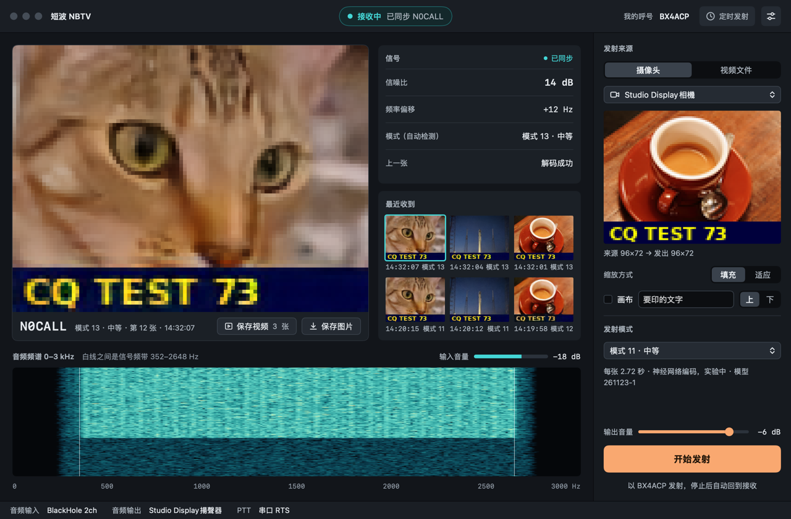
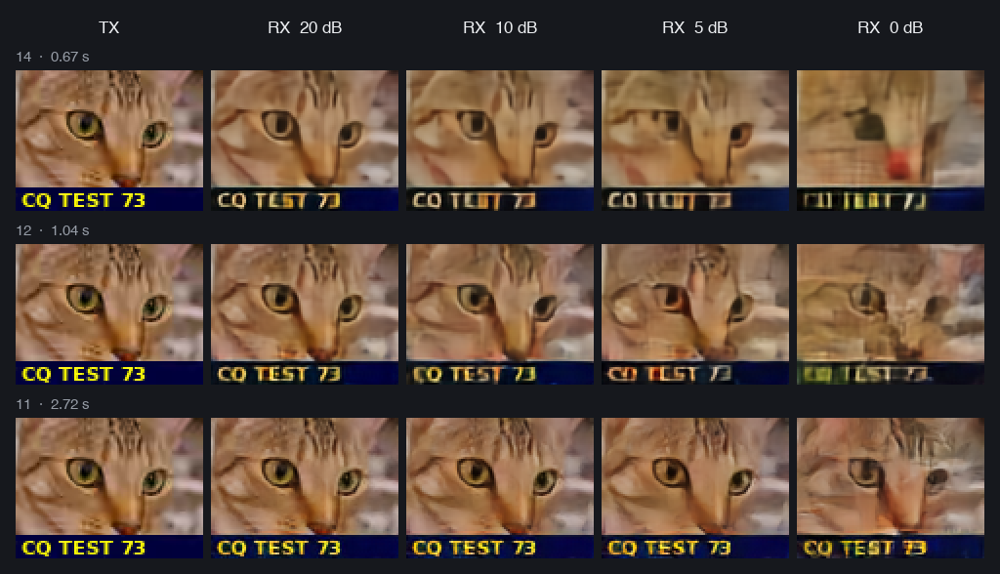

# NBeeTv

[繁體中文](README.md) · **简体中文** · [日本語](README.ja.md) · [Español](README.es.md) · [English](README.en.md)

[](https://github.com/pepefrog1234/NBeeTv/actions/workflows/build.yml)

短波业余无线电用的窄带电视（NBTV）软件：通过普通 SSB 电台的音频，收发 96×72 的彩色画面，最快每 0.67 秒一张。

画面由神经网络直接变成 OFDM 载波上的值，没有量化，也没有纠错码。信号变弱时画面是慢慢变模糊，而不是整张收不到。



> 仍处于实验阶段：调制方式、模型与接收机主要是用信道仿真验证的，实际上机的测试还不多。

## 收到的画面是什么样子



最左边一列（TX）是发出去的画面，右边四列（RX）是它经过仿真的短波信道之后，在信噪比 20、10、5、0 dB 时收到的样子。
从上到下是模式 14、12、11，每张画面分别用 0.67、1.04、2.72 秒：越慢的模式一张画面发送的值越多，画面越细。

- 信道是 Watterson 模型的“差”信道：两条等强的路径相隔 2 ms，各自衰落，多普勒扩展 1 Hz。信噪比按 3 kHz 的噪声带宽计算。
- 每一格是连续发送 9 张之中画质居中的那一张，不是挑最好的；接收端没有开启“合并最近几帧”。
  0 dB 时 9 张里有 1 到 4 张没有收到，图上是收到的那几张里居中的一张。
- 这张图是用下载包里的命令行工具做的：`nbtv-tx` → `nbtv-chan` → `nbtv-rx`。

## 工作原理

- **信号**：OFDM，49 个载波、间隔 46.875 Hz，占 352–2648 Hz，放得进 SSB 的语音通带。
  每一帧就是一张画面，开头有两个同步用的前导符号，中间散布着导频。
- **画面的编码**：一个卷积网络把 96×72 的画面变成一串实数，两个一组直接作为载波上的 I、Q 值发出去；
  另一个网络把收到的值连同测得的信噪比还原成画面。训练时就加入了噪声、衰落与缺失值，所以收到的值再差，解出来的也只是一张比较模糊的画面。
- **帧头**：每一帧另外带着呼号与帧序号，有卷积码与 CRC 保护。画面不靠帧头也解得出来。
- **接收机**：自动检测模式；容许 ±150 Hz 的频率误差与 ±100 ppm 的采样时钟误差；信号弱到帧头解不出来时，按帧的节拍接着收。
  还可以把最近几帧收到的值合起来解，画面没变的地方会更清楚（只在接收端做，发射端不必配合）。
- **收发双方要用同一份模型**：权重文件在 `models/`，下载包与 app 里都附带了。

## 四个模式

| 模式 | 每张画面 | 一张画面发送的实数 | 0 dB | 10 dB | 20 dB | 说明 |
| --- | --- | --- | --- | --- | --- | --- |
| 14 | 0.67 秒 | 1512 | 20.8 | 24.3 | 26.2 | 最快 |
| 12 | 1.04 秒 | 2592 | 21.8 | 25.6 | 27.8 | |
| 11 | 2.72 秒 | 7776 | 24.3 | 29.2 | 32.8 | 画面最细 |
| 13 | 2.72 秒 | 7776 | 24.4 | 29.4 | 33.1 | 帧与模式 11 相同，换成大四倍的网络 |

三列数字是画质（PSNR，dB）：16 张没有参与训练的照片的平均值，经过完整的收发链路与上面那个仿真的“差”信道。
白噪声信道、其他信噪比与测量方法见[技术说明](docs/TECHNICAL.md)。

## 下载

到 [Releases](https://github.com/pepefrog1234/NBeeTv/releases) 下载自己平台的文件。每一个都是在该平台、该种处理器的机器上构建并跑过测试的。

| 平台 | 处理器 | 文件 | 内容 |
| --- | --- | --- | --- |
| macOS 14 及以上 | Apple 芯片 | `NBeeTv-<版本>-macos-arm64-app.zip` | NBTV.app：收发用的图形界面 |
| macOS 14 及以上 | Intel | `NBeeTv-<版本>-macos-x86_64-app.zip` | NBTV.app |
| macOS 11 及以上 | Apple 芯片 | `NBeeTv-<版本>-macos-arm64.tar.gz` | 命令行工具 |
| macOS 11 及以上 | Intel | `NBeeTv-<版本>-macos-x86_64.tar.gz` | 命令行工具 |
| Linux | x86_64 | `NBeeTv-<版本>-linux-x86_64.tar.gz` | 命令行工具（静态链接，不挑发行版） |
| Linux | arm64 | `NBeeTv-<版本>-linux-arm64.tar.gz` | 命令行工具（静态链接） |
| Windows 10、11 | x86_64 | `NBeeTv-<版本>-windows-x86_64.zip` | 命令行工具 |
| Windows 11 | arm64 | `NBeeTv-<版本>-windows-arm64.zip` | 命令行工具 |

每一包都附带四个模式的权重文件，解压就能用。尚未发布的版本可以在 [Actions](https://github.com/pepefrog1234/NBeeTv/actions/workflows/build.yml) 每一次构建的 Artifacts 里下载（需要登录 GitHub，保留 7 天）。

### macOS 的 app

NBTV.app 没有 Apple 的开发者签名与公证，只有 ad-hoc 签名，所以从网上下载之后第一次打开会被 macOS 拦下来。
确认文件是从这个仓库下载的之后，用下面任意一种方式放行：

- 先打开一次（会被拦下），再到“系统设置 → 隐私与安全”的最下面点“仍要打开”；或者
- 在终端执行 `xattr -dr com.apple.quarantine /Applications/NBTV.app`（路径换成你放 app 的位置）。

第一次使用：

1. 点右上角的设置按钮（或 ⌘,），填写呼号、选择音频的输入与输出设备、选择 PTT 的控制方式：
   不控制（用电台的 VOX）、串口的 RTS／DTR、CAT 指令，或连接到已经在运行的 rigctld。后两种需要另外安装 [Hamlib](https://github.com/Hamlib/Hamlib)。
2. 系统会询问麦克风权限（接收要从音频输入设备收音）；选择摄像头作为发射来源时会询问摄像头权限。
3. 回到主窗口就已经在接收了。在右侧栏选择发射来源（摄像头或视频文件）与发射模式，点“开始发射”。

另外还有定时发射、在画面上印一行字（画布）、把收到的画面保存成图片或视频。界面有繁体中文、简体中文、日语、西班牙语与英语，按系统语言自动切换。
完整的说明在 [apps/macos/README.md](apps/macos/README.md)。

### 命令行工具

Linux 与 Windows 目前只有命令行工具，不能实时收发：发射是把做好的 WAV 文件播放给电台，接收是把电台的声音录成 WAV 文件再解码。

解压之后，可执行文件和 `models/` 在同一个文件夹里，直接运行即可。图像一律是 96×72 的二进制 PPM，可以用 ffmpeg 转换。

```sh
# 把照片转成 96×72 的 PPM
ffmpeg -i photo.jpg -vf scale=96:72 -pix_fmt rgb24 photo.ppm

# 做成可以直接播放给电台的 WAV（--mode 是 11 到 14，--call 是你的呼号）
./nbtv-tx --mode 14 --call N0CALL --out tx.wav photo.ppm

# 把录音解回画面，保存为 received/frame_0.ppm、frame_1.ppm……（--merge：把最近几帧合起来解）
mkdir received
./nbtv-rx --merge --out-dir received recording.wav

# 不接电台先试一次：把 tx.wav 送过仿真的短波信道再解码
./nbtv-chan --channel poor --snr 10 tx.wav rx.wav
./nbtv-rx --out-dir received rx.wav
```

- Windows 上把 `./nbtv-tx` 换成 `.\nbtv-tx.exe`，其他工具也一样。
- macOS 上如果被拦下，先对解压出来的文件夹执行 `xattr -dr com.apple.quarantine <文件夹>`。
- 录音要是 12000 或 48000 Hz 的 WAV，16 位 PCM 或 32 位浮点；多声道时取第一个声道。

| 工具 | 用途 |
| --- | --- |
| `nbtv-tx` | 图像 → 可以播放给电台的 WAV |
| `nbtv-rx` | WAV → 收到的画面；`--json` 是给程序读的输出 |
| `nbtv-chan` | 把 WAV 送过仿真的短波信道（衰落、噪声、频偏、采样时钟误差） |
| `nbtv-sim` | 把发射 → 信道 → 接收整个跑很多次，统计收到几帧与画质 |
| `nbtv-learned` | 不经过调制解调器，只测“画面 ↔ 信道上的值”的模型 |

每个工具加上 `--help` 会列出全部选项（说明文字目前只有繁体中文）。

## 收听卡

作者的电台 **BX4ACP** 会发射这种信号。把你的电台收到的声音录成 WAV 文件，上传到 <https://nbeetv.yakumo.tw>：
解出超过 10 张画面，并且解得出呼号，网站就发给你一张带数字签名的收听卡。不需要登录；录音最长 5 分钟。

网站的程序也在这个仓库里（[apps/web/](apps/web/README.md)），可以给自己的电台架设一个。

## 接上电台之前

- 收发双方都用 USB（或数据模式）。发射与接收的滤波器都要覆盖 352–2648 Hz，比它窄会切掉边缘的载波。
- 两部电台的频率差要在 ±150 Hz 以内。
- 关掉会改变波形的处理：发射端的语音压缩与均衡，接收端的降噪（NR）与自动陷波。
- OFDM 的峰值比平均值高很多。把输出音量调到 ALC 不动作为止，平均功率会比额定功率低不少，这是正常的。
- 发射之前，请确认当地的法规允许这种发射方式。

## 从源代码构建

需要 CMake 3.20 及以上版本与支持 C++20 的编译器（GCC、Xcode 的 clang、Visual Studio 的 MSVC 都可以）。核心不需要其他库。

```sh
git clone https://github.com/pepefrog1234/NBeeTv.git
cd NBeeTv
cmake -S . -B build
cmake --build build --config Release
ctest --test-dir build -C Release --output-on-failure
```

工具在 `build/tools/`（Visual Studio 是 `build/tools/Release/`）。测试会用到 `models/` 的权重文件，全部跑完要几分钟。

macOS 的 app 用另一个构建目录，需要 Xcode 与 Ninja：

```sh
cmake -S . -B build-app -G Ninja -DNBTV_BUILD_MACOS_APP=ON -DNBTV_BUILD_TESTS=OFF -DNBTV_BUILD_TOOLS=OFF
cmake --build build-app
open build-app/apps/macos/NBTV.app
```

| 路径 | 内容 |
| --- | --- |
| `core/` | 与平台无关的 C++20 核心库：OFDM 收发、同步、信道估计、神经网络的推理。对外只有一个 C API（`core/include/nbtv/nbtv.h`） |
| `sim/` | 短波信道仿真 |
| `tools/` | 命令行工具；`tools/learned/` 是模型的训练与导出程序（Python、PyTorch） |
| `models/` | 模型的权重文件 |
| `apps/macos/` | macOS 的 app（SwiftUI） |
| `apps/web/` | 收听卡网站（Python、FastAPI） |

## 目前的限制

- 文字与字幕会被抹糊，小块的鲜艳颜色会变淡。
- 帧与呼号没有验证身份的机制，谁都可以用任何呼号发出画面。
- Linux 与 Windows 还没有图形界面，也不能实时收发。
- 命令行工具的说明与下面的详细文档目前只有繁体中文。

## 文档

以下文档目前只有繁体中文。

- [技术说明](docs/TECHNICAL.md)：仿真结果、接收机的行为、帧结构与设计上的取舍、还没做的事
- [macOS 的 app](apps/macos/README.md)
- [模型与训练](tools/learned/README.md)
- [收听卡网站](apps/web/README.md)
- [规格草案 v0.1](短波%20NBTV%20軟體規格草案%20v0.1.md)：写于改用神经网络之前，OFDM 参数、前导符号与导频的部分仍然适用

## 许可证

代码以 [GNU 通用公共许可证第 3 版（GPL-3.0）](LICENSE) 发布。

模型的权重（`models/`）是用 [COCO](https://cocodataset.org/) val2017 的照片训练的。那些照片的版权属于各位拍摄者，各自采用不同的知识共享（Creative Commons）许可，其中有些仅限非商业使用。
权重随项目一起提供；要用于业余无线电实验以外的用途之前，请自行确认。
