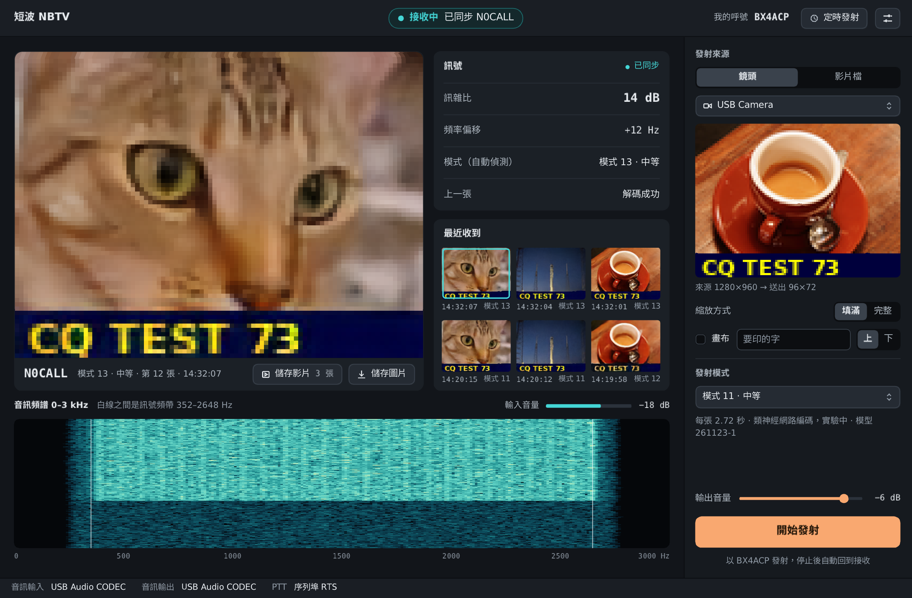

# Windows 與 Linux 的桌面 app（nbtv-gui）

把 [macOS 的 app](../macos/README.md) 搬到 Windows 與 Linux：同樣的版面、同樣的收發流程，一個執行檔。
視窗、音訊裝置、鏡頭、開檔存檔的對話框用 [SDL 3](https://libsdl.org)，介面上的元件用 [Dear ImGui](https://github.com/ocornut/imgui) 自己畫
（顏色、尺寸照 macOS 版，不是系統原生的元件）。調變解調、畫面的編解碼全部交給核心，而且和 macOS 版一樣只透過
`core/include/nbtv/nbtv.h` 這一個 C API 使用核心。



> 這個 app 是新的。它的每一步都有自動檢查（見[檢查](#檢查)），但還沒有人在真的 Windows、Linux 電腦上接著電台用過：
> 真的音效卡、鏡頭、序列埠的 PTT 都還沒有實機驗證。哪些驗證過、哪些沒有，列在[驗證過與還沒驗證的](#驗證過與還沒驗證的)。

## 執行

下載包解開之後，`nbtv-gui`（Windows 是 `nbtv-gui.exe`）和 `models/` 在同一個資料夾，直接執行。

- **Windows**：執行檔沒有程式碼簽章，第一次執行時 SmartScreen 可能會擋下來；確認檔案是從這個 repo 下載的之後，按「其他資訊 → 仍要執行」。
  不需要另外安裝 Visual C++ 的可轉散發套件。
- **Linux**：需要 glibc 2.35 以上（Ubuntu 22.04、Debian 12、Raspberry Pi OS bookworm 以後）。視窗用 X11 或 Wayland，
  聲音用 PipeWire、PulseAudio 或 ALSA，系統上有哪一個就用哪一個，不必另外裝東西。
  介面的中文、日文要靠系統的字型（例如 Noto Sans CJK：`sudo apt install fonts-noto-cjk`）；找不到的話介面會改用英文顯示。

第一次使用：

1. 按右上角的設定鈕，填呼號、選音訊的輸入與輸出裝置、選 PTT 的控制方式。
2. 回到主視窗就已經在接收了。右側欄選發射來源（鏡頭，或影片檔、圖片）與發射模式，按「開始發射」。
   影片檔或圖片也可以直接拖進視窗。

設定存在系統給這個 app 的目錄裡：Windows 是 `%APPDATA%\NBeeTv\nbtv-gui\settings.txt`，Linux 是 `~/.local/share/NBeeTv/nbtv-gui/settings.txt`。
接上電台之前要注意的事（濾波器、ALC、頻率差）和 macOS 版相同，見 [macOS 版的說明](../macos/README.md#接上電台之前)。

### 要另外安裝才有的功能

| 功能 | 需要 | 沒有裝的時候 |
| --- | --- | --- |
| 用影片檔當發射來源、把收到的畫面存成影片 | [ffmpeg](https://ffmpeg.org)（在 `PATH` 裡，或和 `nbtv-gui` 放在一起；有 `ffprobe` 更好） | 圖片檔（JPEG、PNG、BMP、GIF）照樣能當來源；存影片的按鈕不能按 |
| 用電台的 CAT 指令控制 PTT，或列出電台型號 | [Hamlib](https://github.com/Hamlib/Hamlib) 的 `rigctld`、`rigctl`（Windows 裝官方的安裝程式；Linux 例如 `sudo apt install libhamlib-utils`） | 另外三種 PTT（不控制、序列埠的 RTS／DTR、連到已經開著的 rigctld）不受影響 |

這個程式自己不帶影片的解碼器，也不帶 Hamlib。

### 命令列的參數

```text
nbtv-gui                             開視窗
nbtv-gui --demo                      開視窗，裡面是示範資料，不碰任何裝置（看版面用）
nbtv-gui --selftest [--only 名稱]      不開視窗、不碰任何真的裝置，逐項檢查；有失敗的項目時結束碼是 1
nbtv-gui --snapshot 目錄 [--lang 語言]   不開視窗，把六張版面各算成一張 PNG（語言：zh-Hant、zh-Hans、ja、es、en、all）
nbtv-gui --version
  --settings 檔案      設定存在這個檔案，不用預設的位置
  --lang 語言          這一次用這個語言（開視窗時也會記進設定）
  --report 檔案        --selftest、--snapshot 印的內容也寫一份進這個檔案
  --quit-after 秒數    開視窗之後過這麼久自己結束
```

Windows 上這是視窗程式，從檔案總管啟動時沒有地方印字；`--selftest` 的結果要看，請從命令提示字元執行，或加 `--report`。

環境變數：`NBTV_LANGUAGE`（當成系統的語言，例如 `ja`）、`NBTV_MODEL_DIR`（權重檔放在哪裡；預設找執行檔旁邊的 `models/`）、
`NBTV_NO_DEVICES`（設了就不開音訊輸入與鏡頭）。

## 和 macOS 版不一樣的地方

收發的流程（什麼時候按下 PTT、怎麼接下一張、怎麼收尾、定時發射）是照 macOS 版一步一步搬過來的，下面是不一樣的地方：

- **第一次啟動時發射來源是「影片檔」**（還沒選檔），不是鏡頭：不會一打開就把鏡頭開起來。
- **圖片也能當來源**：「影片檔」可以選圖片，那一張會一直重送。定時發射的來源是圖片時沒有「播完」，改成每次連續送 30 秒。
- **影片靠使用者電腦上的 ffmpeg**：播放時開一個 ffmpeg 把畫面照實際的速度送過來（每秒 10 格，先縮小到 512 點以內），
  暫停就把它結束、記住位置。macOS 版用的是系統的 AVFoundation。
- **介面的語言可以在設定裡選**（macOS 版只跟著系統）。預設跟著系統的語言。
- **設定是蓋在主視窗上的對話框**，不是另一個視窗；選單也是 app 自己畫的。沒有選單列與鍵盤快速鍵（Esc 可以關掉選單與設定）。
- **畫布的字**用系統的粗體字型、由 stb_truetype 畫，所以同一句字的筆畫和 macOS 版、和別台電腦會有一點不同（排法與字級的規則相同）。
- **放開 PTT 之前的靜音是 0.25 秒**（macOS 版 0.1 秒）：不同系統的音效卡手上沒播完的聲音長短不一，留寬一點。
- **同一台電腦同時開兩個**（兩部電台互相收發）：macOS 版要另外建一個 NBTV 2.app；這裡第二個加上 `--settings 另一個檔案` 就有自己的一份設定。
- **沒有搬過來的**：開發用的除錯紀錄（DebugTap）、電腦進入睡眠時自動停止發射；以及 macOS 版在 2026-11-26 加的兩樣：
  發射來源的「圖片序列」（選一批圖片照順序各送一次；這裡的「影片檔」只能選一張圖片重送）、存成影片時在每一張的左上角印上訊雜比的選項。
  定時發射開著的時候會請系統不要因為閒置而睡眠，但使用者自己讓電腦睡眠的話，發射中的那一張不會先收尾。
- **鏡頭的方向**不做修正：畫面照鏡頭給的樣子。

## 建置

需要 CMake 3.20 以上、支援 C++20 的編譯器。設定（configure）時要連得上網路：SDL 3.4.20、Dear ImGui 1.93.0、stb 的兩個標頭檔會在這一步下載，
版本固定，並核對 SHA-256；之後都是靜態連結進執行檔。

```sh
cmake -S . -B build-desktop -DNBTV_BUILD_DESKTOP_APP=ON -DNBTV_BUILD_TESTS=OFF
cmake --build build-desktop --config Release --target nbtv-gui
```

產物是 `build-desktop/apps/desktop/nbtv-gui`（Visual Studio 是 `build-desktop/apps/desktop/Release/nbtv-gui.exe`）。
從建置目錄直接執行時，權重檔用的是專案的 `models/`。要做成可以整包搬走的資料夾：設定時加 `-DNBTV_INSTALL_FLAT=ON`，再
`cmake --install build-desktop --config Release --prefix <目錄>`。

- **Linux**：SDL 要有各種視窗、音訊系統的標頭檔才會把對應的功能編進去。Debian／Ubuntu：

  ```sh
  sudo apt install g++ cmake ninja-build pkg-config \
    libasound2-dev libpulse-dev libpipewire-0.3-dev \
    libx11-dev libxext-dev libxrandr-dev libxcursor-dev libxfixes-dev libxi-dev libxss-dev libxtst-dev libxkbcommon-dev \
    libwayland-dev wayland-protocols libdecor-0-dev libegl1-mesa-dev libgles2-mesa-dev libgl1-mesa-dev libdrm-dev libgbm-dev \
    libdbus-1-dev libudev-dev libibus-1.0-dev
  ```

  這些只有建置時要；做出來的執行檔在執行時才載入系統上有的那幾個，直接相依的只有 glibc
  （`-DNBTV_DESKTOP_STATIC_RUNTIME=ON`，預設就是：把 libstdc++ 連進執行檔）。
- **Windows**：Visual Studio 2022 以上（MSVC）。要讓使用者不必裝 Visual C++ 的可轉散發套件，設定時加 `-DCMAKE_MSVC_RUNTIME_LIBRARY=MultiThreaded`。
- **macOS** 上也編得起來（開發時就是在那裡試的），但發佈給 macOS 的是 [apps/macos](../macos/README.md) 那一個。
- 已經裝了 SDL 3.2 以上、不想再編一次：`-DNBTV_DESKTOP_SYSTEM_SDL3=ON`。

GitHub 上的下載包就是 [`.github/workflows/build.yml`](../../.github/workflows/build.yml) 照這個方式在各個平台上建出來的，`nbtv-gui` 和命令列工具放在同一包。

## 介面的文字

和 macOS 版一樣：原始碼裡給使用者看的文字是繁體中文（同時是每一句的索引），其他四種語言的翻譯表在建置時編進執行檔。
大部分的句子直接沿用 macOS 版的 [`Localizable.strings`](../macos/Localization)；桌面版自己多出來、或 macOS 版的說法裡寫著「Mac」的那幾句放在
[`Localization/`](Localization)。建置時 [`tools/gen_strings.cpp`](tools/gen_strings.cpp) 會檢查程式裡的每一句在四種語言都有翻譯、
要填的值（`%@`、`%d`）對得上，少一句就建不過。`--selftest`、`--snapshot` 這些開發用的輸出不翻譯，一律是繁體中文。

## 原始碼

| 檔案（`src/`） | 內容 | 對應 macOS 版的 |
| --- | --- | --- |
| `main.cpp` | 進入點：參數、視窗、事件迴圈、放大倍率、語言 | `main.swift`、`NBTVApp.swift` |
| `app.hpp/.cpp` | 介面的狀態與收發流程：接收、發射的排程、來源、定時發射 | `AppModel.swift`、`RadioEngine.swift` |
| `ui.hpp/.cpp` | 整個介面：主視窗、設定、發射模式選單、定時發射的面板 | `MainWindow.swift`、`ReceivePanels.swift`、`SidePanel.swift`、`SettingsWindow.swift`、`ModeMenu.swift`、`ScheduleMenu.swift`、`Theme.swift` |
| `core_bridge.hpp/.cpp` | 核心 C API 的 C++ 包裝、模式與模型的清單 | `CoreBridge.swift`、`Modes.swift` |
| `audio.hpp/.cpp` | 音訊裝置的清單、收音、發射用的輸出佇列 | `AudioDevices.swift`、`AudioIO.swift` |
| `sources.hpp/.cpp` | 發射來源：鏡頭、影片檔（ffmpeg）、圖片；縮成 96×72 | `VideoSources.swift` |
| `canvas.hpp/.cpp` | 畫布：印在送出畫面上的字 | `Canvas.swift` |
| `ptt.hpp/.cpp`、`serial.hpp/.cpp`、`net.hpp/.cpp` | PTT 的四種控制方式、序列埠的控制線、對 rigctld 的 TCP 連線 | `PTT.swift` |
| `settings.hpp/.cpp` | 設定檔、定時發射的時刻 | `Settings.swift`、`Schedule.swift` |
| `waterfall.hpp/.cpp` | 瀑布圖 | `Waterfall.swift` |
| `i18n.hpp/.cpp` | 介面的語言 | `Localization.swift` |
| `fonts.hpp/.cpp` | 找系統上的字型檔 | （系統處理） |
| `process.hpp/.cpp`、`tasks.hpp`、`png.hpp/.cpp`、`log.hpp` | 啟動別的程式、執行緒之間交接工作、寫 PNG、開發用的輸出 | |
| `demo.hpp/.cpp`、`snapshot.hpp/.cpp`、`offscreen.hpp/.cpp`、`selftest.hpp/.cpp` | 示範資料、把版面算成圖、不開視窗畫介面、自我測試 | `Demo.swift`、`Snapshot.swift`、`SelfTest.swift` |

執行緒的安排和 macOS 版相同：介面的狀態（`App`）只在主執行緒上讀寫；解調在自己的一條執行緒上（不在音訊的回呼裡、也不在主執行緒上），
影像編碼、PTT、縮圖、開檔各有一條；做完的結果排回主執行緒。主迴圈每一圈呼叫一次 `App::tick()`，發射的排程、定時發射都在裡面照時間做。
視窗被拖著移動、改大小的時候 Windows 與 macOS 會把主執行緒卡在系統自己的迴圈裡，這段時間由 SDL 的事件監看照樣推進（發射中的排程不能停）。

用 CAT 指令按下的 PTT 不會因為序列埠關了就放開，所以按下時另外啟動一個看門的程序（就是 `nbtv-gui` 自己，加上 `--ptt-watchdog`）：
app 不管怎麼結束（當掉、被強制結束），它都會替我們對 rigctld 送「T 0」、把 rigctld 結束。

## 檢查

`nbtv-gui --selftest` 不開視窗、不碰任何真的裝置，目前有 29 項：

- 核心：每個模式送兩幀收兩幀、經過有雜訊有頻偏的模擬通道、只有雜訊時不誤解出畫面；
- 發射的流程（不開音訊裝置，由模擬的輸出照實際的時間把取樣取走，再把取走的聲音解回來）：開頭的靜音、PTT 先按下才送聲音、
  送完目前這張才停、立刻停止、還沒開始送就取消、PTT 失敗、輸出裝置送到一半不回應、畫布的字、沒有呼號時不能發射；
- 來源：圖片、影片檔（用 ffmpeg 現做一段）、播完自動停止、循環播放、移動位置；存圖片、存影片；
- 定時發射：時刻的計算，以及用假的時鐘實際跑一次（包含「正在收別人的畫面時不發射」）；
- PTT：對假的 rigctld、用 Hamlib 內建的假電台（型號 1）實際按下放開、app 突然不在時看門的程序有沒有收拾；
- 介面：不開視窗把每個面板、五種語言、三種視窗大小各畫一次；假裝滑鼠去按每一個按鈕、選單、輸入框，確認真的有作用；
  從「開始發射」鈕按出一次完整的發射；
- 其他：翻譯表、設定檔、字型、縮放、PNG、瀑布圖、輸出佇列、TCP、啟動別的程式。
- `SDL_AUDIODRIVER=dummy` 時多跑一項：用 SDL 的「假」音訊驅動，照平常的方式啟動整個 app、開始接收、發射兩張——
  走的是和真的音效裝置一樣的程式，只是聲音沒有去任何地方。沒有設這個環境變數時這一項略過（自我測試不碰真的音效裝置）。

缺 ffmpeg、Hamlib 或字型時，相關的項目會略過並說明原因；`NBTV_SELFTEST_REQUIRE=ffmpeg,hamlib,cjk,fonts,audio` 可以指定哪些不准略過（CI 用）。

CI（[`build.yml`](../../.github/workflows/build.yml)）在 Windows 與 Linux 的 x86_64、arm64 四種機器上各自建置，然後對著「下載包解開之後」的那一份：
跑完上面的自我測試（含假音訊驅動的那一項）、把六張版面五種語言各算成一張圖（留在那一次執行的 Artifacts，`screens-<平台>`）、
真的開視窗幾秒鐘（示範資料一次、照平常的方式啟動一次；Linux 的機器沒有螢幕，用 xvfb）。Linux 另外檢查執行檔直接相依的只有 glibc。

開發時另外用開著 AddressSanitizer 與 UndefinedBehaviorSanitizer 的版本把整套自我測試跑過一次，沒有報告任何問題。

## 驗證過與還沒驗證的

驗證過的（自動檢查，見上面）：

- 四種機器上建得起來，下載包解開就能執行，找得到自己旁邊的權重檔；
- 收發的整個流程、PTT 的順序、各種出錯時的收尾（都用模擬的輸出與只做紀錄的 PTT）；
- 經過 SDL 的音訊串流收音與送出（假的音訊驅動）；
- 影片檔來源與存影片（Linux：ffmpeg；Windows：CI 的機器上有裝到 ffmpeg 的時候）；
- 用 Hamlib 的假電台走完 CAT 的 PTT，包含看門的程序（Linux、macOS；Windows 沒有）；
- 介面在三種視窗大小、五種語言下畫得出來，每個按鈕有作用。

**還沒驗證的**：

- **真的音效裝置**：Windows（WASAPI）、Linux（PipeWire、PulseAudio、ALSA）上實際從電台收音、把聲音送給電台，都還沒有人試過。
  取樣率的轉換交給 SDL；延遲多少、會不會斷音，不知道。
- **真的電台**：沒有在任何一部電台上發射或接收過。
- **序列埠的 RTS／DTR**：Windows（COM 埠）與 Linux（`/dev/ttyUSB*`、`/dev/ttyACM*`）的程式只編譯過、測過「開不起來要回報原因」，沒有接過真的介面。
- **鏡頭**：從來沒有開過（CI 的機器沒有鏡頭；開發用的 Mac 上也沒有開）。
- **Windows 上的 Hamlib**：找 `rigctld.exe` 的位置（`Program Files\hamlib-*\bin`）與啟動它，沒有執行過。
- **Wayland**：CI 用的是 X11（xvfb）。
- **人實際操作**：開檔與存檔的對話框、輸入法（在「畫布」裡打中文）、高解析度與多螢幕、拖動視窗時的行為，都沒有人在 Windows、Linux 上看過。
  版面只看過不開視窗算出來的圖。
- 長時間執行（幾個小時的接收、定時發射）。

## 已知的限制

- 介面是 app 自己畫的：沒有系統的選單列、不支援螢幕閱讀器，文字不能用系統的方式選取。
- 影片的畫面更新率固定是每秒 10 格；影片檔不讀聲音。
- 圖片的 EXIF 方向不處理（手機直拍的照片可能是橫的）。
- 音訊裝置是用名稱記的：兩個裝置同名時分不出來。裝置被拔掉時不會自動改用別的（發射的聲音送錯地方比送不出去糟）。
- 沒有自動更新；新的版本要自己到 Releases 下載。
